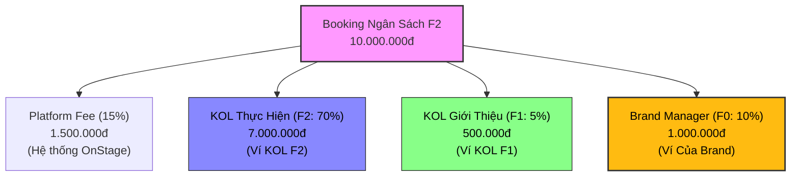

# 🚀 Thiết Kế Tính Năng: Campaign Affiliate Link (KOL Mời KOL Tham Gia Chiến Dịch)

Tài liệu này mô tả chi tiết ý tưởng, luồng vận hành và mô hình phân bổ dòng tiền hoa hồng cho tính năng **Campaign Affiliate Link** — cơ chế cho phép KOL trong chiến dịch (F1) mời thêm các KOL khác (F2) cùng tham gia vào chiến dịch cụ thể đó.

---

## 1. 🎯 Mục Tiêu Tính Năng
* **Tăng tốc tuyển dụng**: Giúp Brand nhanh chóng lấp đầy số lượng KOL/KOC cần thiết cho chiến dịch lớn nhờ tận dụng mạng lưới quan hệ của chính các KOL đang tham gia.
* **Tạo động lực kép**: KOL F1 có thêm nguồn thu nhập thụ động hấp dẫn bằng cách giới thiệu đồng nghiệp chất lượng; KOL F2 tiếp cận được job chất lượng qua giới thiệu uy tín.
* **Tối ưu chi phí cho Brand**: Brand chỉ trả hoa hồng dựa trên kết quả thực hiện công việc thực tế (Pay-on-Performance), giảm thiểu rủi ro booking.

---

## 2. 📊 Sơ Đồ & Mô Hình Phân Bổ Dòng Tiền Campaign (Booking F2)

Khi KOL F2 (được mời bởi KOL F1) hoàn thành công việc trong chiến dịch với ngân sách booking **10.000.000đ**, dòng tiền quyết toán sẽ tự động phân phối qua Smart Contract như sau:



### 👥 Chi tiết phân chia tỷ lệ hoa hồng:

#### 1. 🔵 KOL Thực Hiện (F2) — Nhận 70% thù lao
* **Định nghĩa**: Là KOL trực tiếp đăng ký tham gia chiến dịch qua link giới thiệu của F1 và thực hiện sản phẩm nghiệm thu.
* **Phần trăm nhận**: **70%** giá trị hợp đồng (trích lại 5% làm hoa hồng giới thiệu cho tuyến trên F1).
* **Ví dụ**: Booking 10.000.000đ → KOL F2 nhận **7.000.000đ** vào ví cá nhân.

#### 2. 🟢 KOL Giới Thiệu (F1) — Nhận 5% hoa hồng
* **Định nghĩa**: Là KOL đang tham gia chiến dịch và chia sẻ link giới thiệu của chiến dịch đó cho KOL F2.
* **Phần trăm nhận**: **5%** thù lao của bất kỳ job nào mà KOL F2 hoàn thành trong khuôn khổ chiến dịch này.
* **Ví dụ**: F2 hoàn thành Job 10.000.000đ → F1 nhận **500.000đ** tiền hoa hồng giới thiệu chiến dịch.

#### 3. 🟡 Brand Manager (F0) — Nhận 10% hoa hồng quản lý
* **Định nghĩa**: Là Brand tạo chiến dịch và quản lý tổng thể. Brand nhận hoa hồng quản lý của hệ thống Roster đối với toàn bộ các KOL thực hiện công việc (cả F1 và F2).
* **Phần trăm nhận**: **10%** giá trị thù lao.
* **Ví dụ**: F2 hoàn thành Job 10.000.000đ → Brand nhận **1.000.000đ** vào ví quản lý.

#### 4. 🔴 Phí Nền Tảng OnStage (Platform Fee) — Giữ lại 15%
* **Tỷ lệ**: **15%** dùng để bảo chứng thanh toán và vận hành hạ tầng.

> [!NOTE]
> Khác với luồng Roster toàn hệ thống, hoa hồng F1 nhận được từ F2 trong tính năng này chỉ giới hạn trong phạm vi các job thuộc chiến dịch cụ thể mà F1 đã chia sẻ link mời.

---

## 3. 🛣️ Chi Tiết 4 Bước Vận Hành Luồng Campaign Affiliate

```
CAMPAIGN AFFILIATE FLOW
──────────────────────────────────────────────────────────────────
[1] LẤY LINK CHIẾN DỊCH
     KOL F1 đăng nhập tài khoản Talent → vào chi tiết Chiến dịch X đang tham gia
     → Nhấn "Lấy Link Giới Thiệu"
     → Hệ thống gen ra link riêng tối ưu:
       `onstage.vn/campaign/chien-dich-loreal-123?ref=tal-1&name=nguyen-mai-anh`

     *Phân tích cấu trúc link:*
     - **Campaign ID & Slug** (`chien-dich-loreal-123`): Chứa ID thực tế `123` để truy xuất database và slug tên chiến dịch phục vụ SEO.
     - **KOL ID** (`ref=tal-1`): Tham số định danh để hệ thống ghi nhận mối quan hệ F1 → F2 khi F2 click apply.
     - **KOL Name** (`name=nguyen-mai-anh`): Slug tên KOL để trang đích hiển thị ngay thông điệp chào mừng cá nhân hóa (*"Nguyễn Mai Anh mời bạn..."*) mà không cần chờ gọi API từ database, tối ưu hóa tốc độ tải trang.

[2] LAN TỎA & APPLY
     KOL F1 gửi link cho KOL F2
     → KOL F2 click link → hiển thị landing page chi tiết chiến dịch
     → F2 bấm "Tham gia ngay" → điền form apply
     → Hệ thống tự động ghi nhận F2 được giới thiệu bởi F1 cho Campaign này

[3] BRAND DUYỆT (F0)
     Brand vào /brand/campaigns/[id] (Danh sách ứng viên)
     → Thấy KOL F2 ứng tuyển kèm badge biểu thị "Được giới thiệu bởi [KOL F1]"
     → Brand bấm Duyệt (Accept) F2 vào chiến dịch

[4] QUYẾT TOÁN & CHI TRẢ (Real-time)
     KOL F2 hoàn thành sản phẩm và gửi nghiệm thu
     → Brand bấm "Quyết toán" chiến dịch
     → Smart Contract tự động giải ngân:
          * 70% về ví KOL F2
          * 5% về ví KOL F1 (Hoa hồng giới thiệu)
          * 10% về ví Brand F0 (Hoa hồng quản lý)
          * 15% chuyển cho OnStage Platform
```

---

## 4. 🔄 So Sánh Sự Khác Biệt Giữa 2 Loại Affiliate Link

| Đặc điểm | Roster Affiliate Link (My Talents) | Campaign Affiliate Link (Campaigns) |
| :--- | :--- | :--- |
| **Mục đích chính** | Mời Talent gia nhập đội ngũ Roster của Brand lâu dài | Mời KOL tham gia gấp vào một chiến dịch cụ thể |
| **Đối tượng tạo link** | Brand (F0) tạo và chia sẻ | KOL F1 đang ở trong campaign tạo và chia sẻ |
| **Phạm vi nhận hoa hồng** | Tất cả các job của Talent trên nền tảng | Chỉ các job phát sinh trong Campaign được chia sẻ |
| **Tỷ lệ chia sẻ** | Brand (F0) nhận 10% từ KOL F1 | Brand (F0) nhận 10%, KOL F1 nhận 5% từ KOL F2 |
| **Trạng thái liên kết** | Vĩnh viễn (cho đến khi huỷ liên kết Roster) | Kết thúc khi chiến dịch đóng quyết toán |

---

## 5. 🎨 Gợi Ý Thiết Kế UI Bổ Sung

### A. Giao diện phía Brand (/brand/campaigns/[id])
* **Danh sách ứng viên**: Hiển thị thêm dòng `Giới thiệu bởi: [Tên KOL F1]` dưới tên KOL F2.
* **Bảng Quyết Toán dòng tiền**: Hiển thị rõ cột breakdown chi phí:
  * *Thù lao KOL thực hiện (70%)*
  * *Hoa hồng Upline giới thiệu (5%)*
  * *Phí quản lý Brand (10%)*

### B. Giao diện phía Talent (/talent/campaigns/[id])
* Thêm widget **"Lan tỏa chiến dịch nhận thưởng"**:
  * Chứa đường link copy dạng rút gọn.
  * Thống kê real-time: `Số người đã mời thành công` và `Hoa hồng dự kiến nhận được (5%)`.
