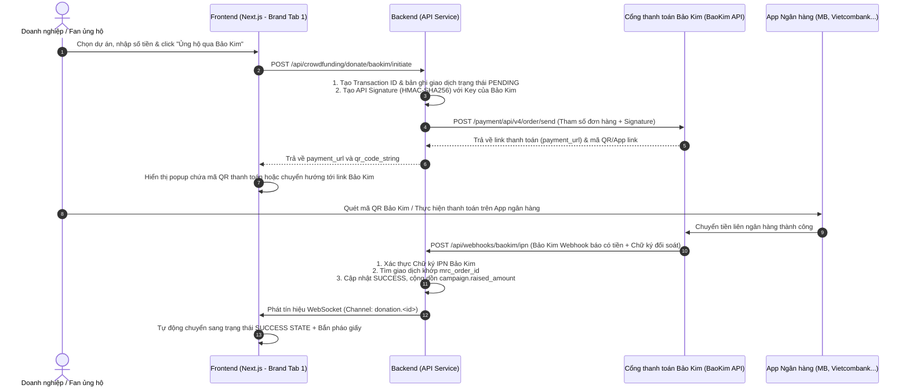

# Hướng Dẫn Triển Khai Chi Tiết và Thiết Kế UI: Luồng 1 - Donate (Thanh Toán Qua Ví Bảo Kim)

Tài liệu này cung cấp đặc tả kỹ thuật chi tiết để triển khai tính năng **Quyên góp Nhân ái (Donate)** thông qua cổng thanh toán **Bảo Kim (BaoKim.vn)**. Theo yêu cầu hệ thống, toàn bộ 4 luồng gây quỹ sẽ được quy hoạch tập trung vào một trang **"Crownfunding" (Quỹ Vương Miện)** duy nhất và chia thành các Tab con ở cả hai phân hệ **Talent** và **Brand**.

---

## 1. Cấu Trúc Quy Hoạch Tab Trên Trang Crownfunding (Quy Mô Hệ Thống)

### A. Phía Talent (Tài năng / Thí sinh)
*   **Vị trí trang chạy:** [app/talent/crownfunding/page.tsx](file:///c:/CONG_VIEC/VNP_OnstageVN/frontend/app/talent/crownfunding/page.tsx)
*   **Thiết kế Layout:** Sử dụng Tab Component của Next.js/Tailwind chia thành 4 Tab con:
    *   **Tab 1: Quyên Góp Nhân Ái (Donate) [Luồng 1 - Tài liệu này]:** Quản lý dự án từ thiện cá nhân, xem tiến độ gây quỹ, viết nhật ký hoạt động thực địa, gửi yêu cầu giải ngân mốc ngân sách (Milestone payout request) kèm chứng từ hình ảnh nghiệm thu.
    *   **Tab 2: Quà Tri Ân (Rewards) [Luồng 2]:** Thiết lập các mốc quà tri ân (giá bán, số lượng, mô tả), quản lý danh sách người mua quà (Fulfillment) và cập nhật mã vận đơn bưu cục.
    *   **Tab 3: Vay Vốn (Lending - P2P/ISA):** Đăng ký vay ngân sách chuẩn bị đi thi. Theo dõi điểm tín dụng cá nhân (từ *Talent Tiering Engine*) và lịch sử trích nợ tự động 25% mỗi job cát-xê.
    *   **Tab 4: Đầu Tư Dài Hạn (Equity/BCC):** Đăng tải hồ sơ Pitching kêu gọi góp vốn đầu tư thương hiệu cá nhân, quản lý hợp đồng BCC điện tử đã ký, xem biểu đồ chia sẻ lợi nhuận (Revenue Split) với nhà đầu tư.

### B. Phía Brand (Nhà tài trợ / Doanh nghiệp & Fans)
*   **Vị trí trang chạy:** `app/brand/crownfunding/page.tsx`
*   **Thiết kế Layout:** Chia thành 4 Tab con tương ứng để Brand tham gia đóng góp và đầu tư:
    *   **Tab 1: Quỹ Nhân Ái (Donate) [Luồng 1 - Tài liệu này]:** Khám phá các dự án từ thiện của các thí sinh đang gây quỹ. Xem chi tiết báo cáo và cổng quyên góp QR Bảo Kim.
    *   **Tab 2: Gói Quà Tri Ân (Rewards) [Luồng 2]:** Xem các dự án nghệ thuật, chọn mua các gói quà (photobook, thiệp cảm ơn...), thanh toán QR Bảo Kim, theo dõi mã vận đơn và bấm xác nhận đã nhận quà để giải ngân Escrow.
    *   **Tab 3: Cho Vay Đầu Tư (Lending - P2P/ISA):** Duyệt danh sách các Talent đang cần vay vốn đi thi, xem đánh giá Tier xếp hạng tín nhiệm và bấm rót vốn cho vay hưởng lãi suất/phí.
    *   **Tab 4: Góp Vốn Thiên Thần (Equity/BCC):** Xem hồ sơ kêu gọi đầu tư dài hạn của Talent hạng A/S, ký kết hợp đồng BCC và rót vốn đầu tư nhận chia sẻ doanh thu tự động từ mọi job booking phát sinh của Talent.

---

## 2. Chi Tiết Giao Diện Tab "Quyên Góp Nhân Ái" (Donate)

### Phía Brand - Tab "Quỹ Nhân Ái" (`app/brand/crownfunding/page.tsx` -> Tab 1)
1.  **Danh sách dự án:** Grid hiển thị các Card dự án của các thí sinh. Mỗi card có: ảnh đại diện dự án, tên thí sinh (có Badge phân hạng S/A/B/C), thanh tiến trình Progress Bar gradient vàng kim phát sáng (`from-amber-200 via-amber-400 to-yellow-600`), phần trăm đã đạt được, số tiền hiện tại và nút **"Đồng hành đóng góp"**.
2.  **Popup Thanh Toán (BaoKim QR Code Modal):**
    *   Mở ra khi bấm "Đồng hành đóng góp".
    *   **Form nhập liệu:** Số tiền đóng góp (Nút chọn nhanh 100k, 200k, 500k hoặc nhập số khác), Tên Brand/Nhà tài trợ vinh danh, Checkbox "Ủng hộ ẩn danh", Lời chúc/nhắn gửi.
    *   **Mã QR thanh toán:** Gọi API Bảo Kim sinh mã QR động (VietQR). Có đồng hồ đếm ngược 10 phút.
    *   **Bảng thông tin sao chép thủ công:** Hiển thị số TK ví Bảo Kim của sàn, số tiền và nội dung chuyển khoản định danh duy nhất (ví dụ: `OSN_DK_123456`) để đối soát tự động, kèm nút Copy nhanh bên cạnh mỗi trường.
    *   **Success Transition:** Hệ thống lắng nghe Socket IPN Bảo Kim báo thành công, tự động ẩn QR và hiển thị màn hình chúc mừng bắn pháo giấy Confetti.

### Phía Talent - Tab "Quyên Góp Nhân Ái" (`app/talent/crownfunding/page.tsx` -> Tab 1)
1.  **Thống kê tổng quan:** Số tiền đã huy động được, số lượng người ủng hộ, số tiền khả dụng có thể xin rút (ví dụ: các mốc đã được phê duyệt).
2.  **Quản lý mốc giải ngân (Milestones):**
    *   Ví dụ: *Mốc 1 (Xây móng trường học) - 20 triệu*, *Mốc 2 (Hoàn thiện phòng học) - 30 triệu*.
    *   Mỗi mốc có nút **"Yêu cầu giải ngân"**. Khi click, mở popup cho phép Talent đăng ảnh chụp/video thi công và biên bản xác nhận của địa phương làm chứng từ đối soát.
3.  **Bảng Nhật ký Dự án (Activity Log):** Cho phép Talent viết bài viết cập nhật tiến độ dự án (kèm tối đa 3 ảnh) hiển thị trực tiếp lên bảng tin của dự án ở phía Brand xem.

---

## 3. Kiến Trúc Dòng Tiền & Tích Hợp Cổng Thanh Toán Bảo Kim (BaoKim.vn)

Hệ thống kết nối với API v4 của Bảo Kim để tạo đơn hàng thanh toán bằng mã QR của hơn 30 ngân hàng và ví điện tử tại Việt Nam.



---

## 4. Đặc Tả Kỹ Thuật (BaoKim API & Database Schema)

### 4.1. Database Schema
Bảng `donate_transactions` được thiết kế để liên kết trực tiếp với các chiến dịch gây quỹ và lưu vết mã đơn hàng đối soát với Bảo Kim:

```sql
CREATE TABLE donate_transactions (
    id VARCHAR(36) PRIMARY KEY, -- ID giao dịch nội bộ OnstageVN
    campaign_id VARCHAR(36) NOT NULL,
    user_id VARCHAR(36) NULL, -- ID Brand/Fan thực hiện donate (nếu có đăng nhập)
    donor_name VARCHAR(100) NOT NULL, -- Tên hiển thị vinh danh thương hiệu
    amount DECIMAL(15, 2) NOT NULL,
    message VARCHAR(255) NULL,
    is_anonymous BOOLEAN DEFAULT FALSE,
    payment_gateway VARCHAR(50) DEFAULT 'baokim',
    mrc_order_id VARCHAR(100) UNIQUE, -- Mã đơn gửi sang Bảo Kim
    baokim_txn_id VARCHAR(100) NULL, -- Mã giao dịch Bảo Kim trả về sau khi thành công
    payment_status VARCHAR(50) DEFAULT 'pending', -- pending, success, failed
    completed_at TIMESTAMP NULL,
    created_at TIMESTAMP DEFAULT CURRENT_TIMESTAMP
);
```

### 4.2. Cấu trúc API Backend - Khởi Tạo Thanh Toán Bảo Kim (PHP/Laravel)

Khi kết nối Bảo Kim API v4, Backend cần tạo chữ ký bảo mật HMAC-SHA256 từ chuỗi truy vấn dữ liệu trước khi gửi request.

```php
use Illuminate\Support\Facades\Http;
use Illuminate\Support\Str;

public function initiateBaoKimDonate(Request $request) {
    $request->validate([
        'campaign_id' => 'required|exists:crowdfunding_campaigns,id',
        'amount' => 'required|numeric|min:10000',
        'donor_name' => 'required|string|max:100',
        'message' => 'nullable|string|max:255',
        'is_anonymous' => 'required|boolean'
    ]);

    $campaign = CrowdfundingCampaign::findOrFail($request->campaign_id);
    $transactionId = Str::uuid()->toString();
    $mrcOrderId = 'ONSTAGE_' . time() . '_' . rand(1000, 9999);

    $transaction = DonateTransaction::create([
        'id' => $transactionId,
        'campaign_id' => $campaign->id,
        'user_id' => auth()->id() ?? null,
        'donor_name' => $request->donor_name,
        'amount' => $request->amount,
        'message' => $request->message,
        'is_anonymous' => $request->is_anonymous,
        'mrc_order_id' => $mrcOrderId,
        'payment_status' => 'pending'
    ]);

    $apiSecret = config('baokim.api_secret');
    $apiKey = config('baokim.api_key');
    $url = config('baokim.api_url') . '/payment/api/v4/order/send';

    $params = [
        'mrc_order_id' => $mrcOrderId,
        'total_amount' => intval($request->amount),
        'description' => 'Ung ho du an ' . Str::ascii($campaign->title),
        'url_success' => config('app.frontend_url') . '/brand/crownfunding?status=success&id=' . $transactionId,
        'url_cancel' => config('app.frontend_url') . '/brand/crownfunding?status=cancel',
        'webhooks' => config('app.api_url') . '/api/webhooks/baokim/ipn',
        'customer_fullname' => $request->donor_name,
        'merchant_id' => config('baokim.merchant_id'),
    ];

    ksort($params);
    $queryString = http_build_query($params);
    $signature = hash_hmac('sha256', $queryString, $apiSecret);
    $params['signature'] = $signature;

    try {
        $response = Http::withHeaders([
            'jwt' => $this->generateBaoKimJWT($apiKey, $apiSecret)
        ])->post($url, $params);

        $result = $response->json();

        if (isset($result['code']) && $result['code'] == 0) {
            return response()->json([
                'status' => 'success',
                'transaction_id' => $transactionId,
                'payment_url' => $result['data']['payment_url'],
                'qr_code_string' => $result['data']['qr_code'] ?? null,
            ]);
        } else {
            return response()->json(['status' => 'error', 'message' => $result['message'] ?? 'BaoKim Error'], 400);
        }
    } catch (\Exception $e) {
        return response()->json(['status' => 'error', 'message' => $e->getMessage()], 500);
    }
}
```
