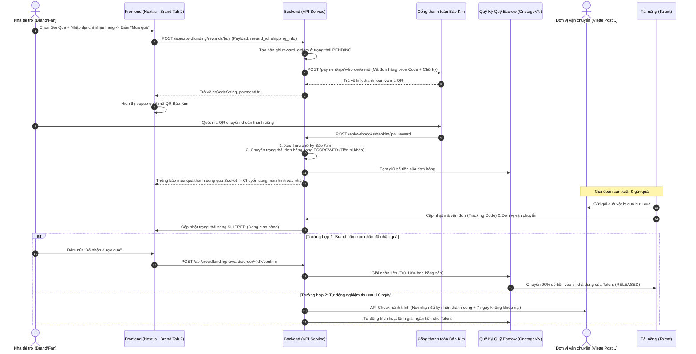

# Hướng Dẫn Triển Khai Chi Tiết và Thiết Kế UI: Luồng 2 - Nhận Quà Tri Ân (Reward-Based Crowdfunding)

Tài liệu này cung cấp đặc tả kỹ thuật chi tiết để triển khai tính năng **Nhận Quà Tri Ân (Reward-Based)** trên OnstageVN. Theo yêu cầu hệ thống, tính năng này được quy hoạch tích hợp tập trung vào một trang **"Crownfunding" (Quỹ Vương Miện)** duy nhất và chia thành các Tab con ở cả hai phân hệ **Talent** và **Brand**.

---

## 1. Cấu Trúc Quy Hoạch Tab Trên Trang Crownfunding (Quy Mô Hệ Thống)

### A. Phía Talent (Tài năng / Thí sinh)
*   **Vị trí trang chạy:** [app/talent/crownfunding/page.tsx](file:///c:/CONG_VIEC/VNP_OnstageVN/frontend/app/talent/crownfunding/page.tsx)
*   **Thiết kế Layout:** Sử dụng Tab Component của Next.js/Tailwind chia thành 4 Tab con:
    *   **Tab 1: Quyên Góp Nhân Ái (Donate) [Luồng 1]:** Quản lý dự án từ thiện cá nhân, xem tiến độ gây quỹ, viết nhật ký hoạt động thực địa, gửi yêu cầu giải ngân mốc ngân sách.
    *   **Tab 2: Quà Tri Ân (Rewards) [Luồng 2 - Tài liệu này]:** Thiết lập các mốc quà tri ân (giá bán, số lượng, mô tả), quản lý danh sách người mua quà (Fulfillment) và cập nhật mã vận đơn bưu cục để kích hoạt giải ngân dòng tiền Escrow.
    *   **Tab 3: Vay Vốn (Lending - P2P/ISA):** Đăng ký vay ngân sách chuẩn bị đi thi. Theo dõi điểm tín dụng cá nhân và lịch sử trích nợ tự động 25% mỗi job cát-xê.
    *   **Tab 4: Đầu Tư Dài Hạn (Equity/BCC):** Kêu gọi góp vốn đầu tư thương hiệu cá nhân, quản lý hợp đồng BCC điện tử đã ký, xem biểu đồ chia sẻ lợi nhuận với nhà đầu tư.

### B. Phía Brand (Nhà tài trợ / Doanh nghiệp & Fans)
*   **Vị trí trang chạy:** `app/brand/crownfunding/page.tsx`
*   **Thiết kế Layout:** Chia thành 4 Tab con tương ứng để Brand tham gia đóng góp và đầu tư:
    *   **Tab 1: Quỹ Nhân Ái (Donate) [Luồng 1]:** Khám phá các dự án từ thiện của các thí sinh đang gây quỹ. Xem chi tiết báo cáo và cổng quyên góp QR Bảo Kim.
    *   **Tab 2: Gói Quà Tri Ân (Rewards) [Luồng 2 - Tài liệu này]:** Xem các dự án nghệ thuật, chọn mua các gói quà tri ân (photobook, thiệp cảm ơn...), thanh toán QR Bảo Kim, theo dõi mã vận đơn và bấm xác nhận đã nhận quà để giải ngân Escrow.
    *   **Tab 3: Cho Vay Đầu Tư (Lending - P2P/ISA):** Duyệt danh sách các Talent đang cần vay vốn đi thi, xem đánh giá Tier xếp hạng tín nhiệm và bấm rót vốn cho vay hưởng lãi suất/phí.
    *   **Tab 4: Góp Vốn Thiên Thần (Equity/BCC):** Xem hồ sơ kêu gọi đầu tư dài hạn của Talent hạng A/S, ký kết hợp đồng BCC và rót vốn đầu tư nhận chia sẻ doanh thu tự động từ mọi job booking phát sinh của Talent.

---

## 2. Chi Tiết Giao Diện Tab "Quà Tri Ân" (Rewards)

### Phía Brand - Tab "Gói Quà Tri Ân" (`app/brand/crownfunding/page.tsx` -> Tab 2)
1.  **Showcase các Dự án & Mốc Quà:**
    *   Hiển thị danh sách dự án nghệ thuật hoặc chuẩn bị đi thi của Talent.
    *   Mỗi dự án hiển thị các **Gói quà tri ân (Reward tiers)** dưới dạng danh sách các thẻ hộp bo góc viền vàng neon hoặc tím thời thượng.
    *   Mỗi thẻ quà ghi nhận: Tên gói quà, Giá bán, Mô tả đặc quyền, Số lượng suất còn lại (ví dụ: *"Đã bán 15/20"*), và nút **"Chọn Gói Quà"**.
2.  **Popup Mua Quà (Checkout Modal & BaoKim QR):**
    *   Mở ra khi bấm "Chọn Gói Quà".
    *   **Form thông tin nhận hàng:** Họ tên, Điện thoại, Địa chỉ nhận hàng (Chọn Tỉnh/Huyện/Xã). Ô nhập ghi chú (yêu cầu riêng của Brand cho món quà).
    *   **Mã QR thanh toán:** Hiển thị mã QR Bảo Kim theo số tiền của gói quà đã chọn. Có đồng hồ đếm ngược 10 phút.
    *   **Success Transition:** Hệ thống tự động chuyển sang trang thành công khi nhận được tín hiệu Webhook từ Bảo Kim qua socket.
3.  **Theo dõi Trạng thái vận đơn (Backer Order Tracking):**
    *   Giao diện hiển thị các gói quà Brand đã mua kèm trạng thái: `Đang xử lý` -> `Đã gửi bưu điện (Mã vận đơn: VN12345)` -> `Đã nhận hàng`.
    *   Nút bấm **"Xác nhận đã nhận quà (Confirm Delivery)"** để người ủng hộ bấm xác nhận khi nhận được quà thực tế, giúp kích hoạt lệnh giải ngân tiền từ Escrow cho Talent.

### Phía Talent - Tab "Quà Tri Ân" (`app/talent/crownfunding/page.tsx` -> Tab 2)
1.  **Thiết lập các gói quà (Reward Tier Editor):**
    *   Form thêm/sửa/xóa gói quà: Đặt tiêu đề quà, giá tiền, số lượng giới hạn, chọn ngày dự kiến giao quà.
2.  **Quản lý giao nhận (Fulfillment Dashboard):**
    *   Bảng hiển thị danh sách người mua quà.
    *   Với mỗi đơn hàng ở trạng thái `Đang xử lý`, Talent có nút **"Gửi Quà"**. Khi bấm vào sẽ hiện popup để nhập **Mã vận đơn (Tracking Code)** và **Đơn vị vận chuyển (Carrier)** để hệ thống đồng bộ trạng thái đơn hàng sang `Đã gửi bưu cục` và gửi thông báo cho người ủng hộ.

---

## 3. Kiến Trúc Dòng Tiền & Tích Hợp Cổng Thanh Toán Bảo Kim (BaoKim.vn)

Tiền sau khi thanh toán thành công qua Bảo Kim sẽ được **giữ trong ví Escrow** của OnstageVN và chỉ giải ngân cho Talent khi có bằng chứng giao hàng thành công.



---

## 4. Đặc Tả Dữ Liệu Kỹ Thuật (Database Schema)

```sql
CREATE TABLE crowdfunding_rewards (
    id VARCHAR(36) PRIMARY KEY,
    campaign_id VARCHAR(36) NOT NULL,
    pledge_amount DECIMAL(15, 2) NOT NULL, -- Số tiền tối thiểu để nhận gói quà
    title VARCHAR(255) NOT NULL,
    description TEXT NOT NULL,
    limit_quantity INT NULL,
    claimed_count INT DEFAULT 0, -- Số suất đã được mua
    estimated_delivery DATE NOT NULL
);

CREATE TABLE reward_orders (
    id VARCHAR(36) PRIMARY KEY,
    reward_id VARCHAR(36) NOT NULL,
    user_id VARCHAR(36) NULL, -- ID Brand/Fan mua quà
    amount DECIMAL(15, 2) NOT NULL,
    customer_name VARCHAR(100) NOT NULL,
    customer_phone VARCHAR(20) NOT NULL,
    shipping_address TEXT NOT NULL,
    notes TEXT NULL,
    mrc_order_id VARCHAR(100) UNIQUE,
    baokim_txn_id VARCHAR(100) NULL,
    payment_status VARCHAR(50) DEFAULT 'pending', -- pending, escrowed, released, refunded
    shipping_status VARCHAR(50) DEFAULT 'processing', -- processing, shipped, delivered, disputed
    carrier_name VARCHAR(100) NULL,
    tracking_code VARCHAR(100) NULL,
    shipped_at TIMESTAMP NULL,
    completed_at TIMESTAMP NULL
);
```
