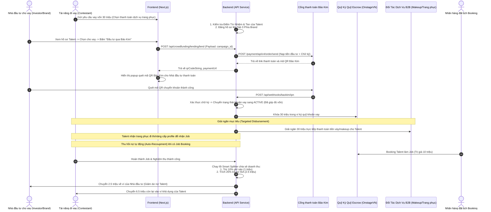

# Hướng Dẫn Triển Khai Chi Tiết và Thiết Kế UI: Luồng 3 - Cho Vay Ngang Hàng (Lending P2P / Hợp Đồng Chia Sẻ Thu Nhập ISA)

Tài liệu này cung cấp đặc tả kỹ thuật chi tiết để triển khai tính năng **Cho Vay Ngang Hàng (Lending P2P)** kết hợp cơ chế **Chia sẻ thu nhập tương lai (ISA - Income Share Agreement)** trên OnstageVN. Luồng này được quy hoạch tập trung vào một trang **"Crownfunding" (Quỹ Vương Miện)** duy nhất ở cả hai phân hệ **Talent** và **Brand**, sử dụng cổng **Bảo Kim (BaoKim.vn)** để nạp tiền đầu tư và lõi **Smart Splitter** của sàn để tự động thu hồi nợ từ cát-xê.

---

## 1. Cấu Trúc Quy Hoạch Tab Trên Trang Crownfunding (Quy Mô Hệ Thống)

### A. Phía Talent (Tài năng / Thí sinh đi vay)
*   **Vị trí trang chạy:** [app/talent/crownfunding/page.tsx](file:///c:/CONG_VIEC/VNP_OnstageVN/frontend/app/talent/crownfunding/page.tsx) -> **Tab 3: Vay Vốn (Lending)**
*   **Mục đích sử dụng:** Quản lý khoản vay cá nhân, theo dõi dư nợ và lịch sử trích nợ tự động.
*   **Các tính năng giao diện cốt lõi:**
    *   **Widget Xếp Hạng Tín Nhiệm (Credit Engine View):** Hiển thị Phân hạng Tier (Hạng S/A/B/C) và Điểm Uy Tín Vận Hành (Tiêu chí số 6 từ *Talent Tiering Engine*). Hệ thống hiển thị trực quan Hạn mức vay tối đa được duyệt (ví dụ: Hạng C được vay tối đa 30,000,000đ; Hạng B được vay 100,000,000đ).
    *   **Form Yêu cầu Vay Vốn (Loan Pitch Request):** Talent nhập số tiền cần vay, lựa chọn mục đích đầu tư (Thanh toán váy dạ hội, Makeup, Khóa học catwalk, PR hình ảnh) và cam kết tỷ lệ trích thu nhập tương lai (ví dụ: `25%` cát-xê mỗi job cho đến khi trả đủ gốc + phí disburse).
    *   **Dashboard Theo Dõi Dư Nợ:** Hiển thị tổng nợ gốc, tổng nợ lũy kế đã trả, số dư nợ còn lại và biểu đồ tiến trình thanh toán.
    *   **Lịch sử Trích Cát-xê (Auto-Deduction Feed):** Danh sách các job booking đã hoàn thành trên hệ thống, số tiền cát-xê nhận được, số tiền `25%` đã bị trích tự động để trả nợ cho nhà đầu tư.

### B. Phía Brand & Investors (Nhà đầu tư cho vay)
*   **Vị trí trang chạy:** `app/brand/crownfunding/page.tsx` -> **Tab 3: Cho Vay Đầu Tư (Lending)**
*   **Mục đích sử dụng:** Duyệt danh mục hồ sơ gọi vốn của Talent và thực hiện cho vay sinh lời (Investor Portal).
*   **Các tính năng giao diện cốt lõi:**
    *   **Grid Danh Sách Hồ Sơ Gọi Vốn (P2P Loan Pitches):** Hiển thị các thẻ (Card) gọi vốn của Talent. Mỗi card hiển thị: Ảnh chân dung Talent, Tier (Hạng), Điểm uy tín, Rating từ các nhãn hàng cũ, Số tiền cần vay, Lãi suất/Phí cam kết và Tỷ lệ trích cát-xê (ISA Rate).
    *   **Popup Chi Tiết & Ký Hợp Đồng ISA (Lending Modal):**
        *   Mở ra khi bấm "Đầu Tư Cho Vay".
        *   Hiển thị chi tiết các điều khoản hợp đồng chia sẻ thu nhập (ISA) điện tử được chuẩn hóa pháp lý.
        *   **Cổng nạp tiền đầu tư Bảo Kim:** Tích hợp mã QR Bảo Kim để nhà đầu tư nạp tiền giải ngân cho khoản vay.
    *   **Dashboard Quản Lý Giao Dịch Đầu Tư (Investor Portfolio):** Nhà đầu tư theo dõi tổng số tiền đã cho vay, số tiền nợ đã thu hồi được thực tế và lợi nhuận tích lũy từ các Talent.

---

## 2. Kiến Trúc Dòng Tiền & Tích Hợp Bảo Kim (BaoKim.vn)

Điểm cốt lõi của Luồng 3 là **tiền giải ngân không chuyển tiền mặt cho Talent** để chống rủi ro nợ xấu, mà thanh toán trực tiếp cho bưu cục/đối tác trên B2B Marketplace của sàn. Nợ được thu hồi tự động qua các job B2B trong tương lai.



---

## 3. Đặc Tả Triển Khai Kỹ Thuật (BaoKim API & Smart Splitter)

### 3.1. Cơ sở dữ liệu mở rộng cho Luồng 3

```sql
-- Lưu các đề án/chiến dịch kêu gọi vay vốn
CREATE TABLE crowdfunding_campaigns (
    id VARCHAR(36) PRIMARY KEY,
    talent_id VARCHAR(36) NOT NULL,
    type VARCHAR(50) DEFAULT 'lending',
    title VARCHAR(255) NOT NULL,
    description TEXT NOT NULL,
    goal_amount DECIMAL(15, 2) NOT NULL, -- Số tiền cần vay
    raised_amount DECIMAL(15, 2) DEFAULT 0.00,
    supporters_count INT DEFAULT 0,
    status VARCHAR(50) DEFAULT 'pending_review', -- active, settled (đã trả hết nợ), defaulted (nợ xấu)
    b2b_provider_id VARCHAR(36) NULL, -- ID đối tác B2B sẽ nhận tiền giải ngân trực tiếp
    created_at TIMESTAMP DEFAULT CURRENT_TIMESTAMP
);

-- Quản lý hợp đồng cho vay và theo dõi thu hồi nợ lũy kế
CREATE TABLE isa_contracts (
    id VARCHAR(36) PRIMARY KEY,
    talent_id VARCHAR(36) NOT NULL,
    investor_id VARCHAR(36) NOT NULL,
    campaign_id VARCHAR(36) NOT NULL,
    investment_amount DECIMAL(15, 2) NOT NULL, -- Tiền đầu tư gốc
    repayment_cap DECIMAL(15, 2) NOT NULL, -- Ngưỡng thu hồi nợ tối đa (gốc + phí disburse, ví dụ: gốc x 1.2)
    share_rate DECIMAL(5, 2) NOT NULL, -- Tỷ lệ trích cát-xê mỗi job (ví dụ: 25.00)
    accumulated_repaid DECIMAL(15, 2) DEFAULT 0.00, -- Số tiền đã hoàn trả lũy kế
    payment_status VARCHAR(50) DEFAULT 'active', -- active, completed, defaulted
    created_at TIMESTAMP DEFAULT CURRENT_TIMESTAMP
);
```

### 3.2. Logic Backend - Phân chia doanh thu tự động khi nghiệm thu Booking (Smart Splitter)
Khi một Job booking được Brand xác nhận nghiệm thu thành công, Backend chạy đoạn mã sau để kiểm tra xem Talent có hợp đồng nợ ISA hoạt động hay không để tự động trích nợ:

```php
public function completeAndDisburseBooking($bookingId) {
    $booking = Booking::findOrFail($bookingId);
    
    if ($booking->status !== 'completed' || $booking->payment_status !== 'escrowed') {
        throw new \Exception("Booking is not ready for disbursement");
    }

    $talentId = $booking->talent_id;
    $compensationAmount = $booking->compensation_amount;
    
    // Tính phí hoa hồng sàn (mặc định 10%)
    $platformFee = $compensationAmount * ($booking->platform_commission_rate / 100);
    $remainingAmount = $compensationAmount - $platformFee;

    // 1. Kiểm tra xem Talent có hợp đồng nợ ISA nào đang hoạt động (active)
    $activeISA = IsaContract::where('talent_id', $talentId)
                             ->where('payment_status', 'active')
                             ->first();

    $repaymentAmount = 0;
    
    if ($activeISA) {
        // Tính số tiền trích nợ theo tỷ lệ share_rate (ví dụ 25%)
        $repaymentAmount = $remainingAmount * ($activeISA->share_rate / 100);
        
        // Kiểm tra xem số tiền trích nợ có vượt quá số dư nợ còn lại hay không
        $remainingDebt = $activeISA->repayment_cap - $activeISA->accumulated_repaid;
        if ($repaymentAmount > $remainingDebt) {
            $repaymentAmount = $remainingDebt; // Chỉ trích đủ số nợ còn lại
        }
        
        $remainingAmount -= $repaymentAmount;
    }

    DB::transaction(function () use ($booking, $activeISA, $platformFee, $repaymentAmount, $remainingAmount) {
        // Cập nhật trạng thái Booking
        $booking->update([
            'payment_status' => 'released',
            'completed_at' => now()
        ]);

        // 2. Chuyển phí sàn vào tài khoản doanh thu sàn
        PlatformWallet::increment('balance', $platformFee);

        // 3. Nếu có trích nợ, chuyển tiền trực tiếp về ví Nhà đầu tư
        if ($activeISA && $repaymentAmount > 0) {
            $activeISA->increment('accumulated_repaid', $repaymentAmount);
            
            // Cập nhật ví Nhà đầu tư
            $investorWallet = UserWallet::where('user_id', $activeISA->investor_id)->first();
            $investorWallet->increment('available_balance', $repaymentAmount);
            
            // Ghi nhận log lịch sử thanh toán nợ
            Transaction::create([
                'user_id' => $activeISA->investor_id,
                'amount' => $repaymentAmount,
                'type' => 'isa_repayment',
                'description' => "Thu hồi nợ ISA từ Talent ID " . $booking->talent_id . " qua Job ID " . $booking->id
            ]);

            // Nếu đã trả đủ nợ, chuyển trạng thái hợp đồng sang COMPLETED
            if ($activeISA->accumulated_repaid >= $activeISA->repayment_cap) {
                $activeISA->update(['payment_status' => 'completed']);
                
                // Cập nhật trạng thái chiến dịch gây quỹ sang SETTLED
                $activeISA->campaign->update(['status' => 'settled']);
            }
        }

        // 4. Giải ngân số tiền còn lại vào ví của Talent
        $talentWallet = UserWallet::where('user_id', $booking->talent_id)->first();
        $talentWallet->increment('available_balance', $remainingAmount);
        
        Transaction::create([
            'user_id' => $booking->talent_id,
            'amount' => $remainingAmount,
            'type' => 'booking_payout',
            'description' => "Nhận cát-xê Job ID " . $booking->id . " (Đã khấu trừ phí sàn và trích nợ ISA)"
        ]);
    });

    return response()->json(['status' => 'success', 'repaid_amount' => $repaymentAmount]);
}
```

---

## 4. Chính Sách Phòng Ngừa Nợ Xấu & Chế Tài Vi Phạm

Để đảm bảo quyền lợi cho các nhà đầu tư P2P, hệ thống áp dụng các chế tài nghiêm ngặt sau:

1.  **Anti-Bypass (Khóa cổng nhận show ngoài):** Talent ký hợp đồng ISA cam kết mọi giao dịch đặt lịch làm việc bắt buộc phải đi qua OnstageVN.
    *   Hệ thống quét tự động các bài đăng social media của Talent để phát hiện hành động quảng bá cho Brand khác.
    *   Nếu phát hiện Talent cố tình nhận show trực tiếp ngoài app để trốn nợ, điểm uy tín của Talent sẽ bị trừ thẳng về 0, chuyển trạng thái tài khoản sang `Bị Khóa/Nợ Xấu`.
2.  **Đặc quyền thu hồi nợ liên kết ví:** Hệ thống có quyền tự động đóng băng tài khoản ví của Talent trên OnstageVN nếu có hành vi gian lận trốn nợ, và tự động trích từ bất kỳ dòng tiền hoa hồng Affiliate nào phát sinh tuyến dưới của họ để chuyển trả nhà đầu tư.
3.  **Hội đồng trọng tài pháp lý:** Sử dụng hợp đồng điện tử có giá trị pháp lý làm bằng chứng để OnstageVN đại diện cho Nhà đầu tư tiến hành các thủ tục pháp lý khởi kiện dân sự trong trường hợp Talent cố tình xù nợ với số tiền lớn.
4.  **Tỷ lệ phí disburse Bảo Kim:** Khoản nạp đầu tư của nhà đầu tư đi qua ví Bảo Kim được miễn phí giao dịch nạp, sàn chịu chi phí này để khuyến khích dòng vốn đầu tư cho các Talent trẻ.
