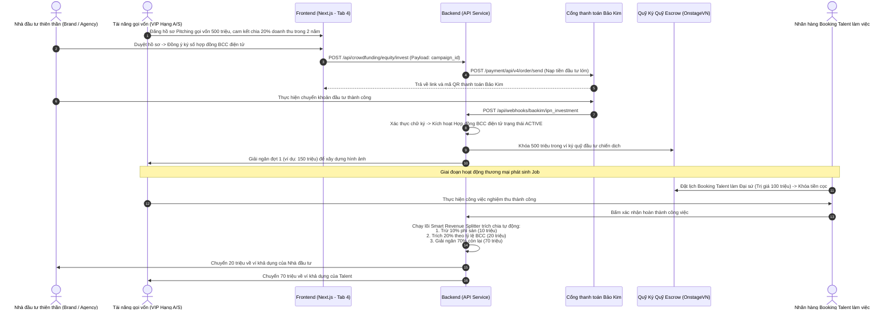

# Hướng Dẫn Triển Khai Chi Tiết và Thiết Kế UI: Luồng 4 - Góp Vốn Cổ Phần Dài Hạn (Equity / Hợp Đồng Hợp Tác Kinh Doanh BCC)

Tài liệu này cung cấp đặc tả kỹ thuật chi tiết để triển khai tính năng **Góp Vốn Cổ Phần Dài Hạn (Equity)** thông qua mô hình **Hợp đồng Hợp tác Kinh doanh (BCC - Business Cooperation Contract)** trên OnstageVN. Luồng này được quy hoạch tập trung vào một trang **"Crownfunding" (Quỹ Vương Miện)** duy nhất ở cả hai phân hệ **Talent** và **Brand**, sử dụng ví **Bảo Kim (BaoKim.vn)** để nạp vốn đầu tư lớn và tích hợp lõi **Smart Revenue Splitter** để tự động phân chia lợi nhuận lâu dài từ mọi job booking của Talent.

---

## 1. Cấu Trúc Quy Hoạch Tab Trên Trang Crownfunding (Quy Mô Hệ Thống)

### A. Phía Talent (Tài năng / Đối tượng gọi vốn đầu tư dài hạn)
*   **Vị trí trang chạy:** [app/talent/crownfunding/page.tsx](file:///c:/CONG_VIEC/VNP_OnstageVN/frontend/app/talent/crownfunding/page.tsx) -> **Tab 4: Cổ Phần (Equity)**
*   **Mục đích sử dụng:** Đăng đề án gọi vốn đầu tư, ký kết hợp đồng BCC và giám sát biểu đồ lợi nhuận chia sẻ cho nhà đầu tư.
*   **Các tính năng giao diện cốt lõi:**
    *   **Trình tạo Hồ Sơ Chào Đầu Tư (Pitch Creator):** Form đăng đề án phát triển sự nghiệp thương mại (ví dụ: *Chiến dịch chinh phục Vương miện quốc tế*, *Dự án Album đầu tay*). Talent nhập: Tổng vốn cần gọi (ví dụ: 500,000,000đ), tỷ lệ chia sẻ doanh thu cam kết (Revenue Share Rate, ví dụ: `20%` tổng doanh thu các job trên app), thời gian hiệu lực hợp đồng (ví dụ: 24 tháng), tải lên Slide Pitch Deck (file PDF) và lộ trình giải ngân theo cột mốc (Milestones).
    *   **Quản Lý Hợp Đồng BCC Ký Số:** Danh sách các Nhà đầu tư thiên thần hoặc Agencies đã ký hợp đồng. Trạng thái ký số (e-KYC và Smart Contract đã verify).
    *   **Biểu Đồ Lợi Nhuận Phân Chia (Revenue Split Analytics):** Thể hiện tổng doanh thu Talent kiếm được từ đầu chiến dịch và số tiền trích chia sẻ `20%` lũy kế đã tự động chuyển cho Nhà đầu tư thông qua hệ thống OnstageVN.
    *   **Yêu Cầu Giải Ngân Theo Mốc (Milestone Release Request):** Nơi Talent cập nhật chứng từ (ví dụ: biên lai đóng học phí khóa học catwalk quốc tế, hóa đơn hoàn thành MV) để yêu cầu Nhà đầu tư giải ngân vốn đợt tiếp theo từ ví ký quỹ đầu tư của dự án.

### B. Phía Brand & Investors (Nhà đầu tư thiên thần / Agencies)
*   **Vị trí trang chạy:** `app/brand/crownfunding/page.tsx` -> **Tab 4: Góp Vốn Thiên Thần (Equity)**
*   **Mục đích sử dụng:** Nghiên cứu hồ sơ Pitching của các Talent lớn và thực hiện rót vốn đầu tư BCC nhận chia sẻ doanh thu lâu dài.
*   **Các tính năng giao diện cốt lõi:**
    *   **Showcase Hồ Sơ Pitching (Investment Gallery):** Grid hiển thị các dự án gọi vốn thương hiệu của các Talent tiềm năng (đặc biệt các Talent hạng A/S có chỉ số ROI cao).
    *   **Trình Duyệt Chi Tiết Dự Án & Ký Số BCC:** Giao diện đọc slide Pitch Deck, xem bảng kế hoạch tài chính và thực hiện ký số hợp đồng BCC điện tử tích hợp e-KYC.
    *   **Cổng Nạp Tiền Đầu Tư Bảo Kim:** Tích hợp liên kết nạp tiền đầu tư lớn thông qua ví Bảo Kim (hỗ trợ chia nhỏ nạp theo đợt giải ngân hoặc nạp một lần chuyển vào ví Escrow giữ tiền đầu tư).
    *   **Dashboard Danh Mục Đầu Tư Thiên Thần (Angel Portfolio Dashboard):** Theo dõi hiệu suất sinh lời của các Talent đã đầu tư. Biểu đồ thống kê số tiền lợi nhuận thu về hàng tháng từ các job booking phát sinh thực tế của từng Talent trên sàn.

---

## 2. Kiến Trúc Dòng Tiền & Tích Hợp Bảo Kim (BaoKim.vn)

Cơ chế cốt lõi của Luồng 4 là ví Bảo Kim đóng vai trò nạp nguồn tiền đầu tư lớn và nạp tiền thanh toán booking từ Brand. Dòng tiền chia sẻ doanh thu được phân rã tự động hoàn toàn qua lõi **Smart Revenue Splitter** tại Backend.



---

## 3. Đặc Tả Triển Khai Kỹ Thuật (BaoKim API & Revenue Splitter)

### 3.1. Cơ sở dữ liệu mở rộng cho Luồng 4

```sql
-- Đăng ký hợp đồng hợp tác kinh doanh BCC dài hạn
CREATE TABLE bcc_contracts (
    id VARCHAR(36) PRIMARY KEY,
    talent_id VARCHAR(36) NOT NULL,
    investor_id VARCHAR(36) NOT NULL,
    campaign_id VARCHAR(36) NOT NULL,
    total_investment DECIMAL(15, 2) NOT NULL, -- Số tiền cam kết đầu tư
    released_investment DECIMAL(15, 2) DEFAULT 0.00, -- Số tiền đã giải ngân cho Talent
    revenue_share_rate DECIMAL(5, 2) NOT NULL, -- Tỷ lệ chia doanh thu (ví dụ: 20.00)
    contract_start_date DATE NOT NULL,
    contract_end_date DATE NOT NULL,
    payment_status VARCHAR(50) DEFAULT 'active', -- active, terminated, expired
    created_at TIMESTAMP DEFAULT CURRENT_TIMESTAMP
);
```

### 3.2. Logic Backend - Lõi Smart Revenue Splitter trích chia cát-xê khi nghiệm thu Booking
Lõi này tự động quét tất cả các hợp đồng BCC đang hoạt động của Talent trước khi giải ngân cát-xê của bất kỳ Job nào:

```php
public function executeRevenueSplit($bookingId) {
    $booking = Booking::findOrFail($bookingId);
    
    if ($booking->status !== 'completed' || $booking->payment_status !== 'escrowed') {
        throw new \Exception("Booking is not ready for split");
    }

    $talentId = $booking->talent_id;
    $compensationAmount = $booking->compensation_amount;
    
    // Tính phí hoa hồng sàn (mặc định 10%)
    $platformFee = $compensationAmount * ($booking->platform_commission_rate / 100);
    $netAmount = $compensationAmount - $platformFee;

    // 1. Quét tìm tất cả hợp đồng BCC dài hạn đang hoạt động (active) của Talent
    $activeBCCs = BccContract::where('talent_id', $talentId)
                             ->where('payment_status', 'active')
                             ->get();

    $splits = [];
    $totalSplitRate = 0;

    foreach ($activeBCCs as $bcc) {
        $shareAmount = $netAmount * ($bcc->revenue_share_rate / 100);
        $splits[] = [
            'bcc_contract_id' => $bcc->id,
            'investor_id' => $bcc->investor_id,
            'amount' => $shareAmount,
            'rate' => $bcc->revenue_share_rate
        ];
        $totalSplitRate += $bcc->revenue_share_rate;
    }

    // Kiểm tra tính bảo toàn dòng tiền (Tổng tỷ lệ chia sẻ không được vượt quá 100%)
    if ($totalSplitRate >= 100) {
        throw new \Exception("Total split rate exceeds 100%. Please check BCC contracts.");
    }

    $talentAmount = $netAmount - collect($splits)->sum('amount');

    DB::transaction(function () use ($booking, $platformFee, $splits, $talentAmount) {
        // Cập nhật trạng thái Booking
        $booking->update([
            'payment_status' => 'released',
            'completed_at' => now()
        ]);

        // 2. Chuyển phí sàn vào ví doanh thu sàn
        PlatformWallet::increment('balance', $platformFee);

        // 3. Thực hiện chia tiền cho từng Nhà đầu tư theo tỷ lệ BCC
        foreach ($splits as $split) {
            $investorWallet = UserWallet::where('user_id', $split['investor_id'])->first();
            $investorWallet->increment('available_balance', $split['amount']);
            
            // Ghi nhận lịch sử giao dịch
            Transaction::create([
                'user_id' => $split['investor_id'],
                'amount' => $split['amount'],
                'type' => 'bcc_revenue_share',
                'description' => "Nhận chia sẻ doanh thu " . $split['rate'] . "% từ Talent ID " . $booking->talent_id . " qua Job ID " . $booking->id
            ]);
        }

        // 4. Chuyển phần cát-xê còn lại vào ví khả dụng của Talent
        $talentWallet = UserWallet::where('user_id', $booking->talent_id)->first();
        $talentWallet->increment('available_balance', $talentAmount);

        Transaction::create([
            'user_id' => $booking->talent_id,
            'amount' => $talentAmount,
            'type' => 'booking_payout',
            'description' => "Nhận cát-xê Job ID " . $booking->id . " (Đã trích chia sẻ doanh thu BCC)"
        ]);
    });

    return response()->json([
        'status' => 'success',
        'splits' => $splits,
        'talent_amount' => $talentAmount
    ]);
}
```

---

## 4. Chính Sách Ràng Buộc & Bảo Vệ Quyền Lợi Song Phương (BCC Rules)

Để kiểm soát rủi ro trong đầu tư tài chính dài hạn vào thương hiệu cá nhân:

1.  **Hạn Chế Chuyển Nhượng Độc Quyền Ngoài Hệ Thống:** Trong suốt thời hạn hợp đồng BCC, Talent cam kết không ký kết hợp đồng đại diện độc quyền với bất kỳ Agency nào ngoài hệ thống OnstageVN mà không có sự đồng ý bằng văn bản của Nhà đầu tư. Mọi booking của Talent phát sinh trên các kênh social media được đồng bộ bắt buộc phải quy đổi và thanh toán qua app.
2.  **Chính Sách Chấm Dứt Hợp Đồng Sớm (Early Termination):** Nếu Talent có hành vi vi phạm đạo đức nghiêm trọng gây ảnh hưởng xấu tới hình ảnh thương mại (Scandal), Nhà đầu tư có quyền đơn phương chấm dứt hợp đồng BCC và yêu cầu hoàn trả lại số vốn đầu tư gốc chưa được thu hồi.
3.  **Hỗ Trợ Thanh Toán Phân Kỳ Bảo Kim:** Tích hợp tính năng thanh toán định kỳ hoặc thanh toán phân kỳ của Bảo Kim để giảm tải áp lực giao dịch lớn cho các Nhà đầu tư thiên thần, đồng thời tự động hóa hoàn toàn luồng chuyển tiền về ví mà không tốn phí trung gian.
