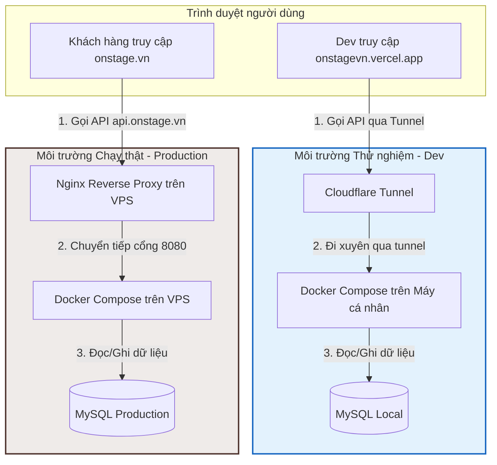

# Quy trình Deploy và Vận hành song song 2 Môi trường (Dev & Production)

Tài liệu này trình bày chi tiết về kiến trúc hoạt động, quy trình phân nhánh mã nguồn (Git branching), và cơ chế quản lý dữ liệu của dự án nhằm đảm bảo việc phát triển tính năng mới ở môi trường **Dev** và vận hành bản **Production (Chạy thật)** diễn ra trơn tru, độc lập và an toàn tuyệt đối.

---

## 1. Tổng quan Mô hình song song

Dự án được thiết lập chạy song song trên 2 môi trường hoàn toàn độc lập về cả hạ tầng máy chủ và cơ sở dữ liệu:

| Đặc tính | Môi trường Dev/Staging (Thử nghiệm) | Môi trường Production (Chạy thật) |
| :--- | :--- | :--- |
| **Domain Frontend** | `https://onstagevn.vercel.app/` | `https://onstage.vn/` |
| **Hạ tầng Frontend**| Vercel Cloud Platform (Tự động build) | VPS Ubuntu `118.70.132.119` (Chạy bằng `pm2`) |
| **Nhánh Git (Frontend)**| `dev` | `main` |
| **API Endpoint Backend**| `https://[cloudflare-tunnel-url].trycloudflare.com/api` | `https://api.onstage.vn/api` |
| **Hạ tầng Backend** | Docker Compose chạy trên **Máy tính cá nhân** của Dev | Docker Compose chạy trên **Server VPS** `118.70.132.119` |
| **Cơ sở dữ liệu (DB)** | MySQL chạy ở Docker Local (Dữ liệu ảo để test) | MySQL chạy trên Server VPS (Dữ liệu khách hàng thật) |

---

## 2. Kiến trúc Luồng dữ liệu (Data Flow)

Sơ đồ dưới đây minh họa cách yêu cầu từ trình duyệt đi tới các môi trường tương ứng mà không hề đụng chạm hay can thiệp chéo lẫn nhau:



---

## 3. Trả lời các câu hỏi quan trọng

### 3.1. Hai domain này có xảy ra xung đột gì với nhau không?
**Không bao giờ xảy ra xung đột.**
* **Lý do:** Bản build của frontend trên Vercel và bản chạy trên VPS được đặt ở 2 hạ tầng mạng khác nhau. Khi mã nguồn Next.js được build, nó chỉ tương tác với API URL được nhúng cứng vào code client-side tại thời điểm đó (Môi trường Dev sử dụng domain Cloudflare Tunnel tạm thời, môi trường Prod sử dụng domain chính `api.onstage.vn`). Trình duyệt của người dùng truy cập trang nào sẽ chỉ giao tiếp duy nhất với máy chủ của trang đó.

### 3.2. Dữ liệu (Data) giữa 2 domain có bị lẫn lộn với nhau không?
**Không lẫn lộn dữ liệu 100%.**
* **Lý do:** 
  * Khi bạn thực hiện các thao tác (đăng ký tài khoản, gửi tin nhắn, tạo campaign...) trên trang **Dev (`onstagevn.vercel.app`)**, yêu cầu sẽ đi qua Cloudflare Tunnel và chỉ ghi nhận vào Database MySQL chạy cục bộ trong Docker trên máy tính cá nhân của bạn.
  * Mọi dữ liệu của khách hàng thật trên **Prod (`onstage.vn`)** được lưu trữ trực tiếp tại MySQL chạy trên ổ đĩa của Server VPS đặt tại Datacenter.
  * Hai cơ sở dữ liệu này nằm trên 2 thiết bị phần cứng cách xa nhau và không hề có bất kỳ kết nối mạng hay đồng bộ nào giữa chúng. Do đó, bạn có thể tạo, sửa, xóa dữ liệu ảo trên bản dev vô tư mà không sợ ảnh hưởng đến dữ liệu thực tế của khách hàng.

---

## 4. Quy trình Coding và Deploy chuẩn

Để vận hành an toàn và giữ cho 2 môi trường luôn đồng bộ tính năng mới, bạn hãy tuân thủ quy trình phân nhánh Git và Deploy dưới đây:

### Bước 1: Viết code và Test trên nhánh `dev`
1. Lập trình viên checkout sang nhánh `dev` ở máy local để code.
2. Mở file cấu hình `.env` của backend local để cấu hình kết nối local. Chạy tool `cloudflared` ở local để có URL Tunnel (Ví dụ: `https://xyz.trycloudflare.com`).
3. Cập nhật biến `NEXT_PUBLIC_API_URL` trên Vercel của dự án thành URL Tunnel đó.
4. Push code lên nhánh `dev` của repository:
   ```bash
   git add .
   git commit -m "feat: thêm tính năng X"
   git push origin dev
   ```
5. Vercel tự động nhận diện và deploy bản mới nhất của nhánh `dev` lên `onstagevn.vercel.app`. Tiến hành cầm điện thoại hoặc thiết bị khác truy cập để test tính năng vừa code.

### Bước 2: Merge code từ `dev` lên `main` (Khi tính năng đã chạy ổn định)
Sau khi test kỹ trên nhánh `dev` và xác nhận không có lỗi, tiến hành gộp code vào nhánh `main` để chuẩn bị đưa lên môi trường chạy thật:

1. Tạo một **Merge Request** trên GitLab gộp nhánh `dev` vào nhánh `main` (hoặc merge thủ công ở máy local):
   ```bash
   git checkout main
   git merge dev
   git push origin main
   ```

### Bước 3: Deploy lên Production Server
Sau khi nhánh `main` đã có code mới nhất, tiến hành deploy lên server VPS:

1. Di chuyển vào thư mục `deploy` trên máy tính local của bạn:
   ```bash
   cd C:\CONG_VIEC\VNP_OnstageVN\deploy
   ```
2. Chạy lệnh Deployer để đẩy code lên server:
   ```bash
   ./vendor/bin/dep deploy onstage.vn:frontend-server-local-45 -vvv
   ```
   * *Deployer sẽ tự động SSH vào VPS, pull code nhánh `main` về, ghi đè file cấu hình `.env` của Production (trong đó chứa `NEXT_PUBLIC_API_URL=https://onstage.vn/api`), chạy build và restart lại NodeJS/PM2 trên server.*
3. **Lưu ý quan trọng đối với Backend:** Nếu tính năng mới có thêm bảng dữ liệu hoặc cột mới trong database (migration), bạn phải SSH vào server và chạy lệnh cập nhật database của Laravel Production:
   ```bash
   cd /var/www/manager-kol-model/api-admin/current
   docker compose exec app php artisan migrate --force
   docker compose exec app php artisan optimize:clear
   docker compose exec app php artisan opcache:clear
   ```
