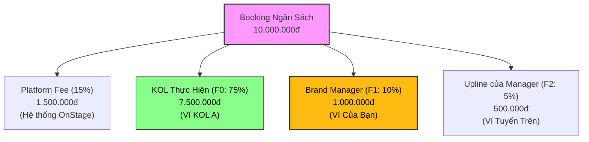

# 💰 Luồng Hoạt Động & Nhận Hoa Hồng Affiliate (Roster Manager)

Tài liệu này mô tả chi tiết luồng vận hành dòng tiền và hoa hồng affiliate khi tài khoản **Brand** đóng vai trò là **Talent Manager** quản lý mạng lưới Roster KOL/KOC trên nền tảng OnStage.

---

## 1. 📊 Sơ Đồ Tổng Quan Phân Bổ Dòng Tiền (Commission Model)

Khi một nhãn hàng đặt Booking cho **KOL A (F0)** thuộc Roster của bạn với ngân sách **10.000.000đ**, dòng tiền sẽ tự động được phân chia theo tỷ lệ cố định qua Hợp đồng thông minh (Smart Contract) như sau:

---

## 2. 🛣️ Chi Tiết 5 Bước Trong Luồng Nhận Hoa Hồng

### Bước 1: Thiết Lập Liên Kết Roster (Kích Hoạt F1)
1. **Gửi Lời Mời**: Bạn (tài khoản Brand) vào `/brand/my-talents`, bấm **"Thêm Talent"** để tìm kiếm và mời KOL.
2. **KOL Đồng Ý**: Hệ thống gửi thông báo đến tài khoản của KOL. KOL truy cập trang `/talent/roster`, bấm **"Chấp nhận"** để liên kết chính thức.
3. **Kết Quả**: KOL chính thức được thêm vào Roster của bạn. Trạng thái chuyển thành **"Đã chấp nhận"** (Accepted).

---

### Bước 2: Nhận Hoa Hồng Trực Tiếp F1 (Roster Jobs)
* **Điều Kiện**: KOL thuộc Roster của bạn thực hiện thành công một Campaign/Booking trên nền tảng.
* **Cách Tính**: Bạn nhận **10%** giá trị thù lao của Booking đó.
* **Ví Dụ**: 
  * KOL Mai Anh hoàn thành Job Livestream trị giá **8.000.000đ**.
  * Ngay khi Campaign được nghiệm thu, tài khoản của bạn tự động cộng thêm: 
    $$\text{Hoa hồng F1} = 8.000.000đ \times 10\% = 800.000đ$$

---

### Bước 3: Chia Sẻ Affiliate Link (Mở Rộng Tuyển Dụng Brand)
* **Cơ Chế**: Mỗi Manager có một **Affiliate Link** duy nhất: `onstage.vn/ref/mgr-xxx`.
* **Cách Hoạt Động**:
  1. Bạn chia sẻ link này cho các Brand đối tác hoặc Agency bạn bè.
  2. Brand đối tác nhấp vào link, đăng ký tài khoản Brand mới trên OnStage.
  3. Khi Brand mới này tạo và thanh toán **Booking đầu tiên** trên hệ thống, bạn sẽ nhận **Bonus Affiliate 3%** từ ngân sách booking đó.
* **Ví Dụ**: Brand đối tác đăng ký qua link của bạn và book KOL đầu tiên với ngân sách **50.000.000đ**. Bạn nhận ngay hoa hồng giới thiệu:
  $$\text{Bonus Affiliate} = 50.000.000đ \times 3\% = 1.500.000đ$$

---

### Bước 4: Nhận Hoa Hồng Thụ Động MLM (Tuyến Dưới F2 & F3)
* **Cơ Chế**: Các KOL trong Roster của bạn dùng mã giới thiệu (Referral Code) của họ để mời KOL khác tham gia OnStage.
* **Cách Hoạt Động**:
  * **Tầng F2**: Khi KOL F2 (tuyến dưới do KOL F1 của bạn giới thiệu) nhận và hoàn thành Job, bạn nhận **5%** thù lao Job đó.
  * **Tầng F3**: Khi KOL F3 (tuyến dưới của F2) hoàn thành Job, bạn nhận **2%** thù lao Job đó.
* **Ví Dụ**: 
  * KOL F1 Mai Anh giới thiệu bạn học là KOL F2 Lê Mai tham gia OnStage.
  * Lê Mai nhận được Job quay Video Review trị giá **10.000.000đ** từ một nhãn hàng khác.
  * Khi Job hoàn thành, bạn nhận hoa hồng thụ động F2:
    $$\text{Hoa hồng F2} = 10.000.000đ \times 5\% = 500.000đ$$

---

### Bước 5: Đối Soát Số Dư & Rút Tiền (Payout)
1. **Cập Nhật Số Dư**: Tất cả các khoản hoa hồng (F1 Roster, F2 MLM, Affiliate Brand) được cộng dồn thời gian thực (Real-time) vào ví quản lý của bạn tại mục **Số dư khả dụng**.
2. **Yêu Cầu Thanh Toán**: Bấm nút **"Rút tiền về ví"** trên dashboard.
3. **Chuyển Khoản**: Hệ thống tự động phê duyệt và chuyển tiền về tài khoản ngân hàng liên kết của bạn (ví dụ: Techcombank) và cập nhật giao dịch vào bảng **Lịch sử thanh toán** ở trạng thái "Thành công".

---

## 3. 📝 Bảng Tổng Hợp So Sánh Các Loại Hoa Hồng

| Loại Hoa Hồng | Tỷ Lệ | Cơ Sở Tính | Người Chi Trả | Tần Suất Nhận |
| :--- | :---: | :--- | :--- | :--- |
| **F1 (Roster Jobs)** | **10%** | Ngân sách Booking của KOL trong Roster | Brand Thuê KOL | Mỗi khi KOL hoàn thành Job |
| **Affiliate Brand** | **3%** | Giá trị Booking đầu tiên của Brand được giới thiệu | Nền tảng trích trả | 1 lần duy nhất trên mỗi Brand mới |
| **F2 MLM (Thụ động)** | **5%** | Ngân sách Booking của KOL F2 | Brand Thuê KOL F2 | Mỗi khi KOL F2 hoàn thành Job |
| **F3 MLM (Thụ động)** | **2%** | Ngân sách Booking của KOL F3 | Brand Thuê KOL F3 | Mỗi khi KOL F3 hoàn thành Job |
