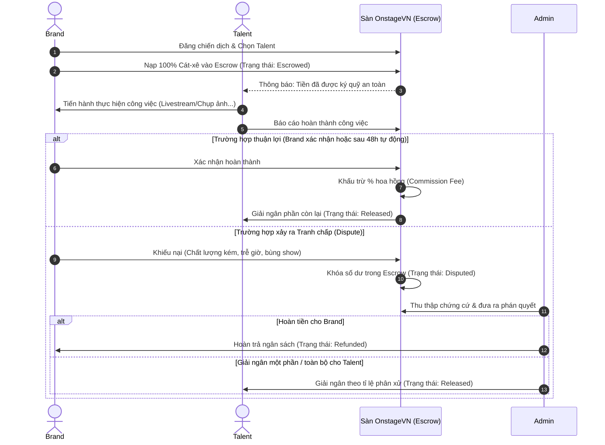

# Tài liệu Hệ thống Ký quỹ (Escrow System) - OnstageVN

Hệ thống **Ký quỹ (Escrow System)** là một trong những tính năng cốt lõi thuộc mô hình vận hành khép kín của nền tảng OnstageVN. Hệ thống này đóng vai trò trung gian thanh toán bảo mật nhằm bảo vệ quyền lợi tài chính tối đa cho cả hai đối tượng: **Brands (Nhà tuyển dụng/Doanh nghiệp)** và **Talents/KOLs/Models (Đối tác cung cấp dịch vụ)**.

---

## 1. Quỹ Escrow là gì?

Quỹ Ký quỹ (Escrow Fund) là tài khoản trung gian của sàn OnstageVN dùng để giữ tạm thời ngân sách thanh toán cho một hợp đồng booking hoặc chiến dịch truyền thông. 

Khi một giao dịch booking được xác nhận, tiền từ phía Brand sẽ được chuyển và **khóa** tại quỹ Escrow này. Tiền sẽ không được chuyển ngay cho Talent mà chỉ được giải ngân sau khi công việc hoàn thành đúng cam kết và được hai bên nghiệm thu.

### 🛡️ Vai trò bảo vệ song phương:
* **Đối với Brand:** Loại bỏ hoàn toàn rủi ro bị "bùng show" (KOL nhận cọc nhưng không đến diễn) hoặc chất lượng công việc không đạt yêu cầu. Nếu có sự cố, Brand có quyền khiếu nại để nhận lại tiền từ quỹ.
* **Đối với Talent:** Loại bỏ rủi ro bị quỵt cát-xê, chậm thanh toán từ phía nhãn hàng. Vì tiền đã được nạp sẵn vào Escrow của sàn trước khi làm việc, Talent hoàn toàn yên tâm cống hiến.

---

## 2. Dữ liệu Kỹ thuật liên quan (Database Schema Mapping)

Trong cơ sở dữ liệu của dự án, quỹ Escrow và luồng thanh toán được theo dõi thông qua các bảng sau:

### Bảng `bookings` (Quản lý Booking):
* `compensation_amount`: Tổng số tiền chi trả cho Talent.
* `platform_commission_rate`: Tỷ lệ hoa hồng sàn thu (mặc định là `10.00%`).
* `platform_commission_amount`: Số tiền hoa hồng sàn sẽ khấu trừ.
* `status`: Trạng thái booking (`pending`, `confirmed`, `in_progress`, `completed`, `cancelled`, `disputed`).
* `payment_status`: Trạng thái dòng tiền Escrow (`pending`, `escrowed` - đã giữ tiền, `released` - đã giải ngân, `refunded` - đã hoàn trả).

### Bảng `agencies` (Quản lý Ví Agency/KOL):
* `escrow_balance`: Số dư ký quỹ hiện tại của Agency/Talent (tiền đang bị khóa chờ job hoàn thành).

---

## 3. Luồng hoạt động của Quỹ Escrow (Workflow)

Dưới đây là sơ đồ trình tự hoạt động của dòng tiền qua quỹ Escrow:

### Các bước chi tiết trong luồng vận hành:

1. **Khớp lệnh & Khóa tiền (Escrow Lock):**
   * Brand đồng ý tuyển chọn Talent cho một job/campaign.
   * Brand nạp 100% ngân sách cát-xê vào ví ký quỹ của sàn. Trạng thái `payment_status` chuyển thành `escrowed`.
   * Hệ thống gửi thông báo cho Talent để bắt đầu thực hiện công việc.

2. **Thực hiện công việc (Execution):**
   * Talent tiến hành công việc (chụp hình, đi sự kiện, đăng bài quảng cáo...).

3. **Nghiệm thu & Giải ngân (Release / Payout):**
   * **Xác nhận thủ công:** Brand bấm nút nghiệm thu "Xác nhận hoàn thành".
   * **Tự động giải ngân:** Sau 48 giờ kể từ khi Talent báo cáo hoàn thành công việc, nếu Brand không phản hồi hoặc không có khiếu nại, hệ thống sẽ tự động kích hoạt lệnh giải ngân.
   * **Trừ phí dịch vụ (Commission Engine):** Sàn tự động khấu trừ phí hoa hồng theo thang biểu phí (ví dụ: `10%` giá trị hợp đồng).
   * **Chuyển tiền về Ví chính:** 90% số tiền còn lại sẽ được chuyển từ `escrow_balance` sang số dư khả dụng (`available_balance`) của Talent/Agency. Trạng thái `payment_status` chuyển thành `released`.

4. **Xử lý tranh chấp (Dispute Management) - Nếu có:**
   * Nếu xảy ra sự cố (KOL trễ hẹn, sai dress code, hoặc Brand thay đổi yêu cầu đột ngột mà không thỏa thuận trước), một trong hai bên có thể mở Ticket Tranh Chấp.
   * Trạng thái booking chuyển sang `disputed`, dòng tiền Escrow tạm thời bị đóng băng.
   * **Ban quản trị (Admin) can thiệp:** Kiểm tra lịch sử chat, hình ảnh, video nghiệm thu để đưa ra quyết định phân chia dòng tiền:
     * **Refunded:** Hoàn trả một phần hoặc 100% tiền cho Brand nếu lỗi nghiêm trọng thuộc về Talent (ví dụ: bùng show).
     * **Released:** Giải ngân toàn bộ hoặc một phần cho Talent tương ứng với khối lượng công việc thực tế đã làm.

---

## 4. Chính sách Hủy Job (Cancellation Policy)

Để bảo vệ quyền lợi đặt lịch của cả hai bên, sàn áp dụng chính sách phạt hủy phòng khi hủy job sát giờ diễn:

| Thời điểm hủy | Phí phạt hủy đối với Brand | Bồi thường nhận được của Talent | Phí xử lý của sàn (Platform fee) |
| :--- | :--- | :--- | :--- |
| **Trước >7 ngày** | 0% | 0% | 0% |
| **Từ 3 - 7 ngày** | 20% giá trị Job | 15% giá trị Job | 5% |
| **Từ 1 - 3 ngày** | 50% giá trị Job | 40% giá trị Job | 10% |
| **Trong vòng 24h** | 100% giá trị Job | 80% giá trị Job | 20% |

> [!NOTE]
> Tất cả các khoản tiền phạt hủy/bồi thường đều được tự động trích xuất và xử lý trực tiếp từ số tiền đang nằm trong quỹ **Escrow** của giao dịch đó.
