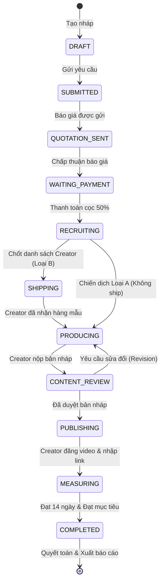

# ONSTAGE.VN – TÀI LIỆU ĐẶC TẢ THIẾT KẾ GIAO DIỆN (UI/UX) VÀ KIẾN TRÚC HỆ THỐNG
## TÍNH NĂNG: CHIẾN DỊCH NỘI DUNG VỚI CREATOR (CREATOR OUTCOME CAMPAIGNS)

> **Mục tiêu tài liệu:** Cung cấp bản đặc tả chi tiết cho UI/UX Designer và Frontend/Backend Developer để thiết kế và lập trình chính xác từng màn hình, từng trường dữ liệu, luồng thao tác và cấu trúc cơ sở dữ liệu.  
> **Cấu trúc Module Code:** Toàn bộ mã nguồn của tính năng Chiến dịch Creator được đặt trực tiếp trong thư mục: **`frontend/app/creator`** (Route: `/creator/campaigns/...`).  
> **Tài liệu tham chiếu nghiệp vụ:** [OnstageVN-Thiet-ke-Chien-dich-Noi-dung-Creator-v2.md](file:///c:/CONG_VIEC/VNP_OnstageVN/frontend/docs/OnstageVN-Thiet-ke-Chien-dich-Noi-dung-Creator-v2.md).

---

# MỤC LỤC

1. [Sơ đồ cấu trúc phân hệ & Bản đồ Route (Sitemap)](#1-sơ-đồ-cấu-trúc-phân-hệ--bản-đồ-route-sitemap)
2. [PHẦN I: THIẾT KẾ MÀN HÌNH CHIẾN DỊCH (`frontend/app/creator/campaigns`)](#phần-i-thiết-kế-màn-hình-chiến-dịch-frontendappcreatorcampaigns)
   - [Màn 01: Danh sách & Tổng quan Chiến dịch Creator](#màn-01-danh-sách--tổng-quan-chiến-dịch-creator)
   - [Màn 02: Tạo mới Yêu cầu Chiến dịch (Wizard 4 bước)](#màn-02-tạo-mới-yêu-cầu-chiến-dịch-wizard-4-bước)
   - [Màn 03: Xem & Chốt Báo giá Chiến dịch](#màn-03-xem--chốt-báo-giá-chiến-dịch)
   - [Màn 04: Chi tiết & Theo dõi Tiến độ Chiến dịch](#màn-04-chi-tiết--theo-dõi-tiến-độ-chiến-dịch)
   - [Màn 05: Duyệt Video / Nội dung nháp](#màn-05-duyệt-video--nội-dung-nháp)
   - [Màn 06: Báo cáo Hiệu quả & Tổng kết Chiến dịch](#màn-06-báo-cáo-hiệu-quả--tổng-kết-chiến-dịch)
3. [PHẦN II: THIẾT KẾ MÀN HÌNH THAO TÁC CREATOR](#phần-ii-thiết-kế-màn-hình-thao-tác-creator)
   - [Màn 07: Lời mời Hợp tác Chiến dịch](#màn-07-lời-mời-hợp-tác-chiến-dịch)
   - [Màn 08: Cập nhật Địa chỉ Nhận hàng & Theo dõi Vận đơn](#màn-08-cập-nhật-địa-chỉ-nhận-hàng--theo-dõi-vận-đơn)
   - [Màn 09: Không gian Làm việc & Tải lên Bản nháp Video](#màn-09-không-gian-làm-việc--tải-lên-bản-nháp-video)
   - [Màn 10: Xem Phản hồi & Cập nhật Phiên bản Chỉnh sửa](#màn-10-xem-phản-hồi--cập-nhật-phiên-bản-chỉnh-sửa)
   - [Màn 11: Báo cáo Lượt xem, Thưởng & Quyết toán Thu nhập](#màn-11-báo-cáo-lượt-xem-thưởng--quyết-toán-thu-nhập)
4. [PHẦN III: THIẾT KẾ CẤU TRÚC DỮ LIỆU & VÒNG ĐỜI TRẠNG THÁI](#phần-iii-thiết-kế-cấu-trúc-dữ-liệu--vòng-đời-trạng-thái)
5. [PHẦN IV: DANH SÁCH MÀN HÌNH PHÁT TRIỂN](#phần-iv-danh-sách-màn-hình-phát-triển)

---

# 1. SƠ ĐỒ CẤU TRÚC PHÂN HỆ & BẢN ĐỒ ROUTE (SITEMAP)

Toàn bộ các route nằm trực tiếp dưới thư mục gốc `frontend/app/creator`:

| Mã màn | Tên màn hình | URL Route | Vị trí file trong `frontend/app/creator` | Vai trò |
|---|---|---|---|---|
| `CR-01` | Danh sách Chiến dịch Creator | `/creator/campaigns` | `campaigns/page.tsx` | Nhãn hàng / Quản lý |
| `CR-02` | Tạo yêu cầu Chiến dịch (Wizard) | `/creator/campaigns/create` | `campaigns/create/page.tsx` | Nhãn hàng |
| `CR-03` | Xem & Duyệt Báo giá | `/creator/campaigns/[id]/quotation` | `campaigns/[id]/quotation/page.tsx` | Nhãn hàng |
| `CR-04` | Chi tiết & Tiến độ Chiến dịch | `/creator/campaigns/[id]` | `campaigns/[id]/page.tsx` | Nhãn hàng |
| `CR-05` | Duyệt Video / Bản nháp | `/creator/campaigns/[id]/content-review` | `campaigns/[id]/content-review/page.tsx` | Nhãn hàng |
| `CR-06` | Báo cáo Hiệu quả Chiến dịch | `/creator/campaigns/[id]/report` | `campaigns/[id]/report/page.tsx` | Nhãn hàng |
| `CR-07` | Lời mời Tham gia Chiến dịch | `/creator/campaigns/invitations/[id]` | `campaigns/invitations/[id]/page.tsx` | Creator |
| `CR-08` | Nhập Địa chỉ & Vận chuyển | `/creator/campaigns/[id]/shipping` | `campaigns/[id]/shipping/page.tsx` | Creator |
| `CR-09` | Nộp Bản nháp Video | `/creator/campaigns/[id]/submit-draft` | `campaigns/[id]/submit-draft/page.tsx` | Creator |
| `CR-10` | Phản hồi & Cập nhật Phiên bản | `/creator/campaigns/[id]/revisions` | `campaigns/[id]/revisions/page.tsx` | Creator |
| `CR-11` | Theo dõi View & Thu nhập | `/creator/campaigns/[id]/earnings` | `campaigns/[id]/earnings/page.tsx` | Creator |

---

# PHẦN I: THIẾT KẾ MÀN HÌNH CHIẾN DỊCH (`frontend/app/creator/campaigns`)

> **Vị trí mã nguồn:** Toàn bộ code giao diện được đặt tại thư mục **`frontend/app/creator/campaigns/...`** (Route: `/creator/campaigns/...`).

---

## Màn 01: Danh sách & Tổng quan Chiến dịch Creator
* **Mã màn:** `CR-01`
* **Vị trí file:** `frontend/app/creator/campaigns/page.tsx`
* **Route:** `/creator/campaigns`
* **Mục đích:** Xem tổng quan tất cả chiến dịch nội dung đã tạo, theo dõi số lượt xem đã tích lũy, trạng thái từng chiến dịch và tạo nhanh chiến dịch mới.

### 1. Bố cục giao diện (Layout Wireframe)
```text
+-----------------------------------------------------------------------------------------------------------------+
| Header: [ Quản lý Chiến dịch Creator ]                                           [ + Tạo chiến dịch mới (Đỏ) ]  |
|         Theo dõi tiến độ sản xuất nội dung, duyệt video và cam kết lượt xem...                                  |
+-----------------------------------------------------------------------------------------------------------------+
| Bộ lọc: [ Tìm theo tên chiến dịch, mã... ]                [ Tất cả (Đỏ) ] [ Đang chạy ] [ Chờ duyệt ] [ Hoàn tất] |
+-----------------------------------------------------------------------------------------------------------------+
| Bảng Danh Sách Chiến Dịch (Single Unified Table):                                                               |
| --------------------------------------------------------------------------------------------------------------- |
| Chiến dịch / Sản phẩm      | Hình thức     | Tiến độ Lượt xem        | Ngân sách    | Thao tác                  |
| --------------------------------------------------------------------------------------------------------------- |
| [Img] Ra mắt Kem PureSun   | Review trực   | 388.420 / 500.000 Views | 85.000.000 đ | [ Xem chi tiết (Nút đỏ) ] |
|       CP-2026-089          | tiếp          | [======= 78%] Đang đo   |              |                           |
| --------------------------------------------------------------------------------------------------------------- |
| [Img] Nhận diện GlowMax    | Nhắc tên/Logo | 1.054.000 / 1.000.000   | 130.000.000 đ| [ Xem chi tiết (Nút đỏ) ] |
|       CP-2026-074          |               | [====== 100%] Hoàn tất  |              |                           |
| --------------------------------------------------------------------------------------------------------------- |
| [Img] Son Kem Lì Velvet    | Review trực   | 0 / 300.000 Views       | 42.000.000 đ | [ Xem chi tiết (Nút đỏ) ] |
|       CP-2026-092          | tiếp          | [ 0%] Chờ duyệt giá     |              |                           |
+-----------------------------------------------------------------------------------------------------------------+
```

### 2. Thành phần dữ liệu & Thao tác
* **Bảng danh sách duy nhất:** Gộp tất cả thông tin quan trọng vào 1 bảng tinh gọn (Chiến dịch, Hình thức, Tiến độ Views kèm progress bar, Ngân sách, Nút thao tác).
* **Nút bấm:** Toàn bộ nút hành động chính có **nền đỏ (`#C72524`), chữ trắng (`text-white`)** nổi bật và đồng bộ.
* **Hành động:**
  * Click **"Tạo chiến dịch mới"** $\rightarrow$ chuyển đến `/creator/campaigns/create`.
  * Click **"Xem chi tiết"** $\rightarrow$ chuyển đến `/creator/campaigns/[id]`.

---

## Màn 02: Tạo mới Yêu cầu Chiến dịch (Wizard 5 bước)
* **Mã màn:** `CR-02`
* **Vị trí file:** `frontend/app/creator/campaigns/create/page.tsx`
* **Route:** `/creator/campaigns/create`
* **Mục đích:** Form wizard 4 bước trực quan hướng dẫn nhập đầy đủ thông tin sản phẩm, định dạng nội dung và chọn gói lượt xem mục tiêu để nhận báo giá từ Onstage.

### 1. Bố cục 4 bước (Step Wizard)
```text
### 1. Bố cục 5 bước (Step Wizard)
```text
[ 1. Thông tin cơ bản ] ===> [ 2. Nhập sản phẩm ] ===> [ 3. Chọn hình thức ] ===> [ 4. Yêu cầu nội dung ] ===> [ 5. Ngân sách & Gửi ]
```

### 2. Chi tiết từng bước

#### Bước 1: Thông tin cơ bản (Thông tin chung)
* **Tên chiến dịch:** Input text (VD: `Serum ABC – Review tháng 8`).
* **Thương hiệu:** Dropdown chọn nhãn hàng (`ABC Cosmetics`, `PureSun`, `GlowMax`...).
* **Ngành hàng:** Dropdown (`Làm đẹp – Chăm sóc da`, `Trang điểm`, `Thời trang`...).
* **Nền tảng chính:** Dropdown (`TikTok`, `Facebook Reels`, `YouTube Shorts`).
* **Thời gian đo lường lượt xem:** Dropdown (`14 ngày sau khi đăng`).
* **Deadline đăng video:** Datepicker.

#### Bước 2: Chọn & Nhập sản phẩm
* **Tên sản phẩm:** Input text (VD: `Serum ABC Vitamin C`).
* **Mô tả ngắn:** Textarea (Tối đa 200 ký tự).
* **Link sản phẩm:** Input URL (Website / Shopee / TikTok Shop).
* **Giá bán lẻ (VNĐ):** Input number.
* **Ảnh sản phẩm:** Khung tải ảnh dạng lưới kèm nút `+` (Hỗ trợ JPG/PNG tối đa 10MB).

#### Bước 3: Chọn hình thức xuất hiện sản phẩm
* **2 Thẻ lựa chọn trực quan có tích chọn:**
  * **Chỉ xuất hiện / nhắc đến (Placement):** Không cần gửi mẫu. Lồng ghép logo/nhắc tên/banner.
  * **Trải nghiệm & sử dụng trực tiếp (Direct Review):** Gửi sản phẩm mẫu tới Creator để mở hộp và review thực tế.

#### Bước 4: Yêu cầu nội dung chi tiết
* **Độ dài video mong muốn:** Dropdown (`15 – 30 giây`, `30 – 60 giây`, `Trên 60 giây`).
* **Nội dung bắt buộc (Checklist):**
  * [x] Nhắc tên sản phẩm: `Serum ABC`
  * [x] Hiển thị sản phẩm trong video
  * [x] CTA: `Tham khảo sản phẩm tại link bio`
  * [x] Hashtag: `#SerumABC #Onstage`
* **Nội dung / Điểm cần nhấn mạnh:** Textarea (Tối đa 300 ký tự).
* **Tài liệu tham khảo (nếu có):** Nút tải file đính kèm.

#### Bước 5: Gói Lượt xem Mục tiêu & Dự toán Ngân sách
* **Lựa chọn Mục tiêu Views cam kết:** 50K, 100K, 300K, 500K, 1M Views.
* **Bảng tạm tính ngân sách ước tính:** Tự động tính khoảng ngân sách tối thiểu – tối đa và số Creator dự kiến.
* **Nút gửi:** `[ Gửi Yêu Cầu Chiến Dịch ]`.

---

## Màn 03: Xem & Chốt Báo giá Chiến dịch
* **Mã màn:** `CR-03`
* **Vị trí file:** `frontend/app/creator/campaigns/[id]/quotation/page.tsx`
* **Route:** `/creator/campaigns/[id]/quotation`
* **Mục đích:** Xem bảng chi tiết báo giá chính thức, xem quyền lợi cam kết, lịch thanh toán 2 đợt và bấm chấp thuận & đặt cọc 50% hoặc yêu cầu chỉnh sửa.

---

## Màn 04: Chi tiết & Theo dõi Tiến độ Chiến dịch
* **Mã màn:** `CR-04`
* **Vị trí file:** `frontend/app/creator/campaigns/[id]/page.tsx`
* **Route:** `/creator/campaigns/[id]`
* **Mục đích:** Màn hình trung tâm để theo dõi toàn cảnh tiến độ chiến dịch theo thời gian thực (từ lúc tuyển Creator, gửi hàng, duyệt nội dung đến đo lường views).

---

## Màn 05: Duyệt Video / Nội dung nháp
* **Mã màn:** `CR-05`
* **Vị trí file:** `frontend/app/creator/campaigns/[id]/content-review/page.tsx`
* **Route:** `/creator/campaigns/[id]/content-review`
* **Mục đích:** Xem trước bản nháp video của Creator, kiểm tra danh mục checklist tiêu chuẩn (logo, hashtag, thông điệp) và duyệt video hoặc yêu cầu chỉnh sửa kèm timestamp.

---

## Màn 06: Báo cáo Hiệu quả & Tổng kết Chiến dịch
* **Mã màn:** `CR-06`
* **Vị trí file:** `frontend/app/creator/campaigns/[id]/report/page.tsx`
* **Route:** `/creator/campaigns/[id]/report`
* **Mục đích:** Báo cáo chi tiết sau khi kết thúc chiến dịch, tổng hợp số lượt xem đạt được, tỷ lệ hoàn thành cam kết, phân tích tương tác từng video theo ngày và xuất file báo cáo PDF / Excel.

---

# PHẦN II: THIẾT KẾ MÀN HÌNH THAO TÁC CREATOR

---

## Màn 07: Lời mời Hợp tác Chiến dịch
* **Mã màn:** `CR-07`
* **Vị trí file:** `frontend/app/creator/campaigns/invitations/[id]/page.tsx`
* **Route:** `/creator/campaigns/invitations/[id]`
* **Mục đích:** Creator nhận thông báo lời mời, xem chi tiết yêu cầu sản phẩm, thù lao cố định, cơ chế thưởng theo view và quyết định đồng ý hoặc từ chối.

---

## Màn 08: Cập nhật Địa chỉ Nhận hàng & Theo dõi Vận đơn
* **Mã màn:** `CR-08`
* **Vị trí file:** `frontend/app/creator/campaigns/[id]/shipping/page.tsx`
* **Route:** `/creator/campaigns/[id]/shipping`
* **Mục đích:** Sau khi đồng ý tham gia chiến dịch loại Review, Creator nhập thông tin giao hàng và theo dõi hành trình đơn hàng sản phẩm mẫu.

---

## Màn 09: Không gian Làm việc & Tải lên Bản nháp Video
* **Mã màn:** `CR-09`
* **Vị trí file:** `frontend/app/creator/campaigns/[id]/submit-draft/page.tsx`
* **Route:** `/creator/campaigns/[id]/submit-draft`
* **Mục đích:** Creator tải lên file video bản nháp (trước khi đăng lên mạng xã hội) để duyệt nội dung.

---

## Màn 10: Xem Phản hồi & Cập nhật Phiên bản Chỉnh sửa
* **Mã màn:** `CR-10`
* **Vị trí file:** `frontend/app/creator/campaigns/[id]/revisions/page.tsx`
* **Route:** `/creator/campaigns/[id]/revisions`
* **Mục đích:** Xem chi tiết góp ý chỉnh sửa và tải lên phiên bản video sửa đổi (Version 2, Version 3).

---

## Màn 11: Báo cáo Lượt xem, Thưởng & Quyết toán Thu nhập
* **Mã màn:** `CR-11`
* **Vị trí file:** `frontend/app/creator/campaigns/[id]/earnings/page.tsx`
* **Route:** `/creator/campaigns/[id]/earnings`
* **Mục đích:** Sau khi video được duyệt và đăng tải, Creator nhập link video công khai và theo dõi số views được hệ thống ghi nhận mỗi ngày cùng số tiền thưởng tương ứng.

---

# PHẦN III: THIẾT KẾ CẤU TRÚC DỮ LIỆU & VÒNG ĐỜI TRẠNG THÁI



---

# PHẦN IV: DANH SÁCH MÀN HÌNH PHÁT TRIỂN

Hệ thống tập trung vào **11 màn hình cốt lõi** dưới `/creator/campaigns`:

| Thứ tự | Mã màn | Tên màn hình | URL Route | Vị trí file trong `frontend/app/creator` |
|:---:|---|---|---|---|
| **1** | `CR-01` | Danh sách Chiến dịch Creator | `/creator/campaigns` | `campaigns/page.tsx` |
| **2** | `CR-02` | Form Tạo Chiến dịch (4 Bước) | `/creator/campaigns/create` | `campaigns/create/page.tsx` |
| **3** | `CR-03` | Xem & Duyệt Báo giá | `/creator/campaigns/[id]/quotation` | `campaigns/[id]/quotation/page.tsx` |
| **4** | `CR-04` | Chi tiết & Tiến độ Chiến dịch | `/creator/campaigns/[id]` | `campaigns/[id]/page.tsx` |
| **5** | `CR-05` | Duyệt Video / Bản nháp | `/creator/campaigns/[id]/content-review` | `campaigns/[id]/content-review/page.tsx` |
| **6** | `CR-06` | Báo cáo Tổng kết Hiệu quả | `/creator/campaigns/[id]/report` | `campaigns/[id]/report/page.tsx` |
| **7** | `CR-07` | Lời mời Tham gia Chiến dịch | `/creator/campaigns/invitations/[id]` | `campaigns/invitations/[id]/page.tsx` |
| **8** | `CR-08` | Nhập Địa chỉ & Vận chuyển | `/creator/campaigns/[id]/shipping` | `campaigns/[id]/shipping/page.tsx` |
| **9** | `CR-09` | Nộp Bản nháp & Link Video | `/creator/campaigns/[id]/submit-draft` | `campaigns/[id]/submit-draft/page.tsx` |
| **10**| `CR-10` | Xem Góp ý & Cập nhật Phiên bản | `/creator/campaigns/[id]/revisions` | `campaigns/[id]/revisions/page.tsx` |
| **11**| `CR-11` | Đo lường View & Thu nhập | `/creator/campaigns/[id]/earnings` | `campaigns/[id]/earnings/page.tsx` |
