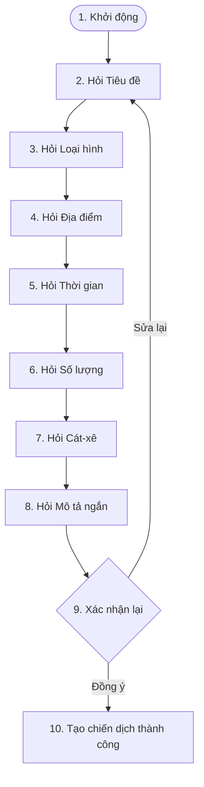

# Thiết kế luồng hội thoại Chatbot Zalo - Tạo chiến dịch (Campaign/Job)

Tài liệu này chi tiết hóa danh sách dữ liệu từ biểu mẫu tạo chiến dịch gốc ([FormCreateJob.tsx](file:///c:/CONG_VIEC/VNP_OnstageVN/frontend/app/brand/campaigns/FormCreateJob.tsx)) nhằm tối ưu hóa thành luồng hội thoại nhanh, mượt mà trên Chatbot Zalo dành cho Brand và Agency.

---

## 1. Phân loại trường thông tin (Field Categorization)

Để chatbot Zalo hoạt động hiệu quả và thân thiện với người dùng di động, các thông tin từ biểu mẫu gốc (20+ trường) được phân thành 2 nhóm chính:

### Nhóm A: Thông tin BẮT BUỘC (Tạo nhanh Job qua Chatbot)
Đây là các thông tin cốt lõi để khởi tạo thành công chiến dịch và hiển thị trên bảng tin công việc.

| Tên Trường (API) | Cột CSDL (Field) | Mô tả trong Form | Định dạng câu trả lời mẫu | Gợi ý cho Chatbot |
| :--- | :--- | :--- | :--- | :--- |
| **`title`** | `campaigns.title` | Tiêu đề Job | *"Tuyển KOL livestream mỹ phẩm", "Cần gấp MC dẫn sự kiện ra mắt"* | Nhập chữ tự do |
| **`jobType`** | `campaigns.job_type` | Loại hình công việc | *"KOL livestream", "Model lookbook", "Beauty KOL/KOC", "PG event", "MC sự kiện"...* | Chọn nhanh qua nút bấm (Quick Replies) |
| **`city`** | `campaigns.city` | Thành phố làm việc | *"Hà Nội", "TP.HCM", "Đà Nẵng"...* | Chọn nhanh hoặc gõ text tự do |
| **`eventDate`** | `campaigns.event_date` | Ngày diễn ra sự kiện | *"15/08/2026", "Thứ bảy tuần này", "Mai"* | Nhận diện ngày thông minh |
| **`talentQuantity`** | `campaigns.talent_quantity` | Số lượng cần tuyển | *"2", "5 người", "Cần 3 bạn"* | Trích xuất số từ câu trả lời |
| **`budget` / `budgetNegotiable`** | `campaigns.budget_min` / `campaigns.budget_max` | Thù lao (Cát-xê) | *"1.500.000 VND/ngày", "Thỏa thuận", "2 triệu"* | Nhập số tiền hoặc click chọn "Thỏa thuận" |
| **`description`** | `campaigns.description` | Mô tả công việc ngắn | *"Chụp hình lookbook thời trang cho nhãn hàng công sở..."* | Nhập text tự do hoặc ghi âm giọng nói |

### Nhóm B: Thông tin BỔ SUNG SAU (Hoàn thiện trên Web/App)
Những thông tin này có thể được bổ sung sau để tối ưu hiệu quả tìm kiếm nhưng **không bắt buộc** phải điền qua chatbot. Chatbot sẽ mặc định đặt giá trị trống hoặc điền giá trị mặc định để rút ngắn luồng.

| Tên Trường (API) | Cột CSDL (Field) | Mô tả trong Form | Giá trị mặc định khi tạo nhanh |
| :--- | :--- | :--- | :--- |
| **`address`** | `campaigns.location` | Địa chỉ chi tiết sự kiện | Lấy trùng với **`city`** |
| **`startDate` / `endDate`** | `campaigns.start_date` / `campaigns.end_date` | Ngày bắt đầu/kết thúc nhận hồ sơ | Ngày tạo / ngày diễn ra sự kiện chính |
| **`applicationDeadline`** | `campaigns.application_deadline` | Hạn ứng tuyển | Trước ngày diễn ra sự kiện chính 1 ngày |
| **`responsibilities`** | `campaigns.responsibilities` | Đầu việc chi tiết | *"Thỏa thuận theo brief"* (Mảng JSON) |
| **`benefits`** | `campaigns.benefits` | Quyền lợi & Đãi ngộ | *"Thỏa thuận theo brief"* (Mảng JSON hoặc text) |
| **`industries`** | `campaigns.industries` | Lĩnh vực | Tự động phân loại (Mảng JSON) |
| **`targetProfiles`** | `campaigns.target_profiles` | Nhóm Talent phù hợp | Tự động phân loại (Mảng JSON) |
| **`heightMin` / `weightMax`** | `campaigns.height_min_cm` / `campaigns.weight_max_kg` | Yêu cầu chiều cao, cân nặng | Để trống (Không yêu cầu) |
| **`experienceMin`** | `campaigns.experience_min_years` | Yêu cầu số năm kinh nghiệm | Để trống (Không yêu cầu) |
| **`campaignImages`** | `campaign_media.path` (disk: `campaign`) | Bộ ảnh chiến dịch (Tối đa 10) | Sử dụng ảnh placeholder của hệ thống |
| **`contactNote`** | `campaigns.contact_note` | Ghi chú liên hệ | Để trống |
| **`escrowed`** | *N/A* (Ký quỹ qua Stripe/MoMo) | Ký quỹ bảo chứng | **`false`** (Ký quỹ sau khi khớp nối thành công) |

---

## 2. Thiết kế luồng hội thoại chuẩn (Standard Conversational Flow)

Dưới đây là thiết kế chi tiết từng bước trò chuyện của chatbot Zalo giúp Brand tạo chiến dịch trong chưa đầy 2 phút.

---

### Chi tiết kịch bản hội thoại

#### Bước 1: Khởi động
* **Chatbot:**
  > Xin chào anh/chị đại diện nhãn hàng! 👋
  >
  > Mình là trợ lý kết nối của **OnstageVN**. Mình sẽ hướng dẫn anh/chị tạo nhanh tin tuyển dụng (Campaign) chỉ trong vài giây.
  >
  > Anh/chị đã sẵn sàng chưa?
* **Nút bấm lựa chọn:**
  * `[ Bắt đầu tạo Job ]`

---

#### Bước 2: Tiêu đề công việc
* **Chatbot:**
  > Tuyệt vời! Trước tiên, hãy nhập **tiêu đề ngắn** cho vị trí cần tuyển dụng nhé.
  >
  > *Ví dụ:*
  > • Tuyển MC sự kiện thời trang hè
  > • Cần 3 bạn mẫu ảnh chụp lookbook
* **Người dùng gõ:** *Cần mẫu lookbook thời trang*

---

#### Bước 3: Loại hình công việc
* **Chatbot:**
  > Vị trí này thuộc nhóm loại hình nào dưới đây để Onstage hỗ trợ gửi thông báo đúng tệp ứng viên?
* **Nút bấm lựa chọn (Quick Replies):**
  * `[ KOL livestream ]`
  * `[ Model lookbook ]`
  * `[ Beauty KOL/KOC ]`
  * `[ PG event ]`
  * `[ MC sự kiện ]`
  * `[ Khác... ]`
* **Người dùng chọn:** *Model lookbook*

---

#### Bước 4: Địa điểm làm việc
* **Chatbot:**
  > Công việc này sẽ diễn ra ở thành phố nào?
* **Nút bấm lựa chọn:**
  * `[ Hà Nội ]`
  * `[ TP.HCM ]`
  * `[ Đà Nẵng ]`
  * `[ Nhập thành phố khác ]`
* **Người dùng chọn:** *TP.HCM*

---

#### Bước 5: Thời gian sự kiện
* **Chatbot:**
  > Ngày diễn ra sự kiện chính là khi nào vậy anh/chị?
  >
  > *Ví dụ:*
  > • 25/08/2026
  > • Cuối tuần này
  > • Thứ 2 tuần sau
* **Người dùng gõ:** *30/08/2026*
* **Hậu phương xử lý:** Tự động parse chuỗi ngày tháng sang format chuẩn `YYYY-MM-DD` để lưu vào **`eventDate`** và tự động gán hạn nộp hồ sơ **`applicationDeadline`** trước đó 2 ngày.

---

#### Bước 6: Số lượng tuyển dụng
* **Chatbot:**
  > Anh/chị cần tuyển bao nhiêu Talent cho chiến dịch này?
  >
  > *Ví dụ: 3*
* **Người dùng gõ:** *Cần 2 bạn*
* **Hậu phương xử lý:** Trích xuất ký tự số `2` và gán vào trường **`talentQuantity`**.

---

#### Bước 7: Mức thù lao (Cát-xê)
* **Chatbot:**
  > Mức thù lao dự kiến cho mỗi Talent là bao nhiêu? (Anh/chị có thể nhập số tiền cụ thể hoặc chọn Thỏa thuận).
* **Nút bấm lựa chọn:**
  * `[ Thỏa thuận ]`
  * `[ 500.000đ/ngày ]`
  * `[ 1.000.000đ/ngày ]`
  * `[ 2.000.000đ/ngày ]`
* **Người dùng gõ hoặc chọn:** *1.500.000đ/ngày*
* **Hậu phương xử lý:** 
  - Nếu chọn *Thỏa thuận*: set `budgetNegotiable: true` và để trống thù lao.
  - Nếu nhập tiền: set `budgetNegotiable: false`, set `budgetMin: 1500000`, `budgetMax: 1500000`.

---

#### Bước 8: Mô tả ngắn (Brief)
* **Chatbot:**
  > Cuối cùng, hãy gửi cho mình một đoạn mô tả ngắn về yêu cầu công việc (trang phục, lịch trình cụ thể hoặc yêu cầu biểu diễn nếu có) để các bạn ứng viên nắm rõ nhé.
* **Người dùng gõ:** *Chụp 20 bộ trang phục hè, phong cách trẻ trung năng động. Địa điểm chụp tại studio Quận 1.*

---

#### Bước 9: Xác nhận và Hoàn tất
* **Chatbot:**
  > 🌟 **Thông tin chiến dịch đã sẵn sàng:**
  >
  > 📝 **Tiêu đề:** Cần mẫu lookbook thời trang
  > 🏷️ **Vị trí:** Model lookbook
  > 📍 **Địa điểm:** TP.HCM
  > 📅 **Thời gian:** 30/08/2026
  > 👥 **Số lượng:** 2 Talent
  > 💰 **Thù lao:** 1.500.000 VND/ngày
  > 📄 **Brief:** Chụp 20 bộ trang phục hè, phong cách trẻ trung năng động. Địa điểm chụp tại studio Quận 1.
  >
  > Anh/chị có muốn đăng tuyển chiến dịch này lên hệ thống Onstage ngay không?
* **Nút bấm lựa chọn:**
  * `[ Đăng tuyển ngay 🚀 ]`
  * `[ Chỉnh sửa lại ✏️ ]`
  * `[ Hủy bỏ ❌ ]`

---

## 3. Tối ưu hóa luồng bằng AI (Đề xuất nâng cao)

Để nâng tầm trải nghiệm của Brand/Agency, Zalo Chatbot của OnstageVN nên tích hợp thêm các công nghệ xử lý thông minh sau:

1. **AI Parsing Brief (Đăng tuyển 1 chạm)**:
   Cho phép người dùng gửi một đoạn text dài (copy-paste từ tin tuyển dụng có sẵn) hoặc tin nhắn thoại chứa nội dung brief. AI (LLM) sẽ tự động phân tích và bóc tách các trường: Tiêu đề, loại hình, địa điểm, mức thù lao, ngày diễn ra, mô tả... để điền vào form xác nhận mà không cần trả lời 8 bước.
   
2. **Auto-suggestions (Gợi ý thù lao)**:
   Khi Brand lựa chọn loại hình là "Model lookbook" ở TP.HCM, chatbot có thể gợi ý khoảng giá cát-xê phổ biến trên thị trường (ví dụ: `1.000.000đ - 2.500.000đ/ngày`) để hỗ trợ định hình ngân sách hợp lý.

3. **QR Link bổ sung ảnh & ký quỹ**:
   Sau khi hoàn tất tạo nhanh chiến dịch, chatbot sẽ gửi kèm một **Mã QR** hoặc **Link rút gọn** trỏ trực tiếp đến trang chi tiết chiến dịch trên Dashboard của Brand. Từ đó, họ có thể nhanh chóng tải lên 10 hình ảnh chất lượng cao và thực hiện nạp tiền ký quỹ (Escrow) bằng ngân hàng hoặc MoMo.
