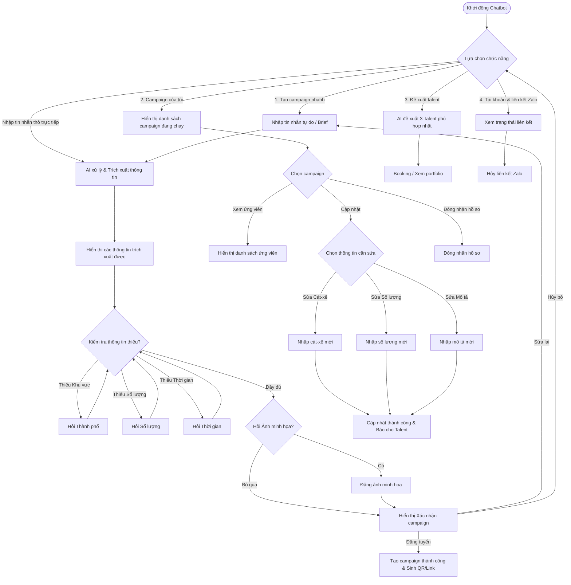

# Thiết kế luồng hội thoại Chatbot Zalo - Tạo & Quản lý Chiến dịch (Campaign/Job)

Tài liệu này chi tiết hóa danh sách dữ liệu từ biểu mẫu tạo chiến dịch gốc ([FormCreateJob.tsx](file:///c:/CONG_VIEC/VNP_OnstageVN/frontend/app/brand/campaigns/FormCreateJob.tsx)) nhằm tối ưu hóa thành luồng hội thoại nhanh, mượt mà trên Chatbot Zalo dành cho Brand và Agency.

---

## 1. Phân loại trường thông tin (Field Categorization) & Quy tắc kiểm dữ liệu (Validation Rules)

Để chatbot Zalo hoạt động hiệu quả trên thiết bị di động, các thông tin từ biểu mẫu gốc (20+ trường) được phân thành 2 nhóm chính:

### Nhóm A: Thông tin BẮT BUỘC (Tạo nhanh Job qua Chatbot)
Đây là các thông tin cốt lõi để khởi tạo thành công chiến dịch và hiển thị trên bảng tin tuyển dụng.

| Tên Trường (API) | Cột CSDL (Field) | Mô tả trong Form | Định dạng & Quy tắc validation | Gợi ý xử lý của Chatbot |
| :--- | :--- | :--- | :--- | :--- |
| **`title`** | `campaigns.title` | Tiêu đề Job | Chữ tự do (10 - 100 ký tự) | Nhập text tự do |
| **`jobType`** | `campaigns.job_type` | Loại hình công việc | Trùng khớp với danh mục loại hình được định cấu hình | Chọn nhanh qua nút bấm (Quick Replies). Nếu gõ tay, AI sẽ nhận diện loại hình gần nhất. |
| **`city`** | `campaigns.city` | Thành phố làm việc | Tên tỉnh/thành phố hợp lệ tại Việt Nam | Chọn nhanh (Hà Nội, TP.HCM, Đà Nẵng...) hoặc gõ tự do. |
| **`address`** | `campaigns.location` | Địa chỉ chi tiết | Chữ tự do (Ví dụ: 123 Nguyễn Huệ, Q1) | Nhập text tự do |
| **`eventDate`** | `campaigns.event_date` | Ngày diễn ra sự kiện | Định dạng `YYYY-MM-DD`. Phải là ngày trong tương lai. | Nhận diện ngày thông minh (Ví dụ: "thứ 7 tuần sau", "30/08" -> parse tự động). |
| **`talentQuantity`** | `campaigns.talent_quantity` | Số lượng cần tuyển | Số nguyên dương (> 0) | Trích xuất số từ câu trả lời tự nhiên (Ví dụ: "cần tuyển 3 bạn" -> `3`). |
| **`budget` / `budgetNegotiable`** | `campaigns.budget_min` / `campaigns.budget_max` | Thù lao (Cát-xê) | Số tiền cụ thể (>= 0) HOẶC đặt cờ Thỏa thuận | Gợi ý nút bấm "Thỏa thuận" hoặc nhập tiền tự do (Ví dụ: "1tr5", "800k/ngày" -> parse số). |
| **`description`** | `campaigns.description` | Mô tả công việc ngắn | Chữ tự do (tối thiểu 20 ký tự) | Nhập text tự do hoặc ghi âm giọng nói chuyển đổi thành văn bản. |

### Nhóm B: Thông tin BỔ SUNG SAU (Hoàn thiện trên Web/App)
Những thông tin này có thể được bổ sung sau để tối ưu hiệu quả tìm kiếm nhưng **không bắt buộc** phải điền qua chatbot. Chatbot sẽ mặc định đặt giá trị trống hoặc điền giá trị mặc định để rút ngắn luồng.

| Tên Trường (API) | Cột CSDL (Field) | Mô tả trong Form | Giá trị mặc định khi tạo nhanh |
| :--- | :--- | :--- | :--- |
| **`startDate` / `endDate`** | `campaigns.start_date` / `campaigns.end_date` | Ngày bắt đầu/kết thúc nhận hồ sơ | Ngày tạo / ngày diễn ra sự kiện chính |
| **`applicationDeadline`** | `campaigns.application_deadline` | Hạn ứng tuyển | Trước ngày diễn ra sự kiện chính 1 ngày |
| **`responsibilities`** | `campaigns.responsibilities` | Đầu việc chi tiết | `["Thỏa thuận theo mô tả"]` (Mảng JSON) |
| **`benefits`** | `campaigns.benefits` | Quyền lợi & Đãi ngộ | `["Thỏa thuận theo mô tả"]` (Mảng JSON) |
| **`industries`** | `campaigns.industries` | Lĩnh vực | Tự động phân loại dựa trên `jobType` |
| **`targetProfiles`** | `campaigns.target_profiles` | Nhóm Talent phù hợp | Tự động phân loại dựa trên `jobType` |
| **`heightMin` / `weightMax`** | `campaigns.height_min_cm` / `campaigns.weight_max_kg` | Yêu cầu chiều cao, cân nặng | Để trống (Không yêu cầu) |
| **`experienceMin`** | `campaigns.experience_min_years` | Yêu cầu số năm kinh nghiệm | Để trống (Không yêu cầu) |
| **`campaignImages`** | `campaign_media.path` (disk: `campaign`) | Bộ ảnh chiến dịch (Tối đa 10) | Sử dụng ảnh placeholder của hệ thống |
| **`contactNote`** | `campaigns.contact_note` | Ghi chú liên hệ | Để trống |
| **`escrowed`** | *N/A* (Ký quỹ qua Stripe/MoMo) | Ký quỹ bảo chứng | **`false`** (Ký quỹ sau khi khớp nối thành công) |

---

## 2. Kiến trúc luồng hội thoại tổng thể (Overall Flow Architecture)

Dưới đây là sơ đồ luồng điều hướng của Chatbot Zalo dành cho đối tượng Brand/Agency, bao gồm các chức năng chính: **Tạo campaign nhanh**, **Campaign của tôi**, **Đề xuất talent phù hợp với campaign**, và **Tài khoản & liên kết Zalo**.



---

## 3. Kịch bản hội thoại chi tiết (Detailed Interaction Scripts)

Để đảm bảo tài liệu được gọn gàng và dễ theo dõi, toàn bộ kịch bản hội thoại tương tác chi tiết từng bước (bao gồm Luồng tạo mới, Luồng cập nhật/quản lý chiến dịch, và Luồng duyệt ứng viên) đã được tách riêng tại:

👉 [campaign-creation-script.md](file:///c:/CONG_VIEC/VNP_OnstageVN/frontend/docs/zalo-chatbot/campaign-creation-script.md)

---

## 4. Tối ưu hóa trải nghiệm bằng AI & Tính năng nâng cao

Để tối ưu hóa trải nghiệm cho Brand/Agency, Zalo Chatbot của OnstageVN được đề xuất tích hợp các công nghệ xử lý thông minh sau:

### 4.1. AI Parsing (Tạo chiến dịch 1-chạm từ tin nhắn tuyển dụng)
Thay vì phải trả lời 8 câu hỏi tuần tự, Brand chỉ cần gửi một đoạn văn bản yêu cầu dài (copy-paste từ tin tuyển dụng trên Facebook, Group...) hoặc gửi tin nhắn thoại (Voice Message). AI (LLM) ở backend sẽ tự động phân tích và trích xuất thực thể (Entity Extraction):

* **Ví dụ tin nhắn người dùng gửi:**
  > *"Bên mình đang cần gấp 2 bạn PG ngoại hình chuẩn cao trên 1m65 chạy event quảng bá nước uống tại rạp phim Galaxy Nguyễn Du Q1 TP.HCM vào ngày 28/08/2026. Lương 600k/ngày chuyển khoản sau event. Ưu tiên bạn nào có kinh nghiệm PG."*
* **AI phân tích và trả ra JSON:**
  ```json
  {
    "title": "Tuyển gấp 2 PG chạy event quảng bá nước uống Galaxy Nguyễn Du",
    "jobType": "PG event",
    "city": "TP.HCM",
    "eventDate": "2026-08-28",
    "talentQuantity": 2,
    "budget": 600000,
    "budgetNegotiable": false,
    "description": "Chạy event quảng bá nước uống tại rạp phim Galaxy Nguyễn Du Q1. Yêu cầu ngoại hình chuẩn cao trên 1m65, ưu tiên có kinh nghiệm PG. Lương chuyển khoản sau event."
  }
  ```
* **Chatbot phản hồi ngay lập tức:**
  > 🤖 **Trợ lý AI đã tự động chuẩn bị thông tin chiến dịch của bạn:**
  > 
  > • **Tiêu đề:** Tuyển gấp 2 PG chạy event quảng bá nước uống Galaxy Nguyễn Du
  > • **Loại hình:** PG event
  > • **Địa điểm:** TP.HCM
  > • **Thời gian:** 28/08/2026
  > • **Số lượng:** 2 Talent
  > • **Thù lao:** 600.000 VND/ngày
  > 
  > Anh/chị có muốn đăng tuyển ngay không?
  > `[ 🚀 Đăng tuyển ngay ]` `[ ✏️ Sửa lại thông tin ]`

### 4.2. Tích hợp Zalo Mini App / Webview quản lý nâng cao
Với các thao tác phức tạp như:
1. **Đăng tải bộ ảnh concept mẫu (Campaign Images)**: Việc gửi 10 ảnh trên chat dễ gây loạn luồng. Chatbot sẽ cung cấp link Webview/Mini App để tải ảnh lên cực nhanh qua giao diện kéo thả.
2. **Ký quỹ bảo chứng cát-xê (Escrow Payment)**: Tích hợp cổng thanh toán MoMo/ZaloPay/Thẻ ngân hàng ngay trong Webview của Zalo để ký quỹ, đảm bảo thù lao cho Talent và gia tăng mức độ uy tín của Job.

### 4.3. Quản lý trạng thái phiên hội thoại (Conversation Session Management)
* **Khôi phục trạng thái (Resume Flow):** Nếu Brand đang tạo Job dở dang (ví dụ: đến bước nhập thù lao) rồi dừng lại quá 10 phút, khi họ tương tác lại, chatbot sẽ nhắc:
  > Mình thấy bạn đang tạo dở chiến dịch **"Cần mẫu lookbook thời trang"**. Bạn có muốn tiếp tục hoàn tất không?
  > `[ ➡️ Tiếp tục điền ]` `[ 🔄 Bắt đầu lại ]`
* **Lệnh thoát nhanh:** Người dùng gõ "Hủy", "Cancel", "Reset" ở bất kỳ bước nào thì chatbot đều lập tức giải phóng phiên và đưa về menu chính.
